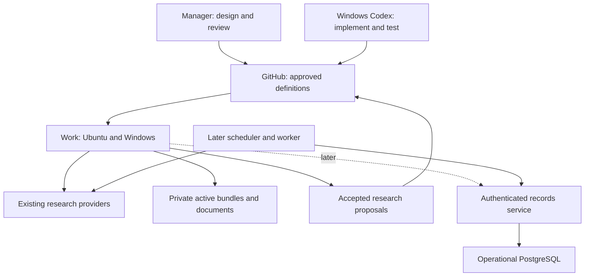

# AOIS — Detailed Implementation Blueprint v1

Publication-safe technical adaptation prepared 24 October 2026 from the supplied 7 October 2026 blueprint. All 40 planning sections and the detailed original technical contracts/roadmap are retained below, with candidate-specific material removed.

**Baseline status:** approved by ChatGPT in the earlier manager review, with clarifications carried below. **Current extension status:** the [general-purpose charter](../PROJECT_CHARTER.md), [roadmap](../ROADMAP.md), and [shared review decision](../decisions/0001-general-purpose-and-review.md) are proposed for Claude review. They define the proposed changes to early private intake/query planning, field neutrality, client distribution and shared management. No future production task is authorized here.

**Reference precedence:** read the current charter/roadmap/decision together with this historical baseline. Their explicitly listed refinements supersede the corresponding original sequence only after shared review; all other baseline contracts remain. Historical product/account observations below are dated 7 October, not current capability tests.

**Privacy adaptation:** real candidate preferences, document names/identities and account inventory removed; no CV content was imported. Generic country/field pilot plans are technical examples, not user defaults.

**Manager clarifications preserved:** current conversation is 02 — AOIS Manager; profile-specific compatibility/eligibility/funding sufficiency requires approved private facts; Task 02 uses synthetic integrity/capability checks rather than building production validators; every Section 9 concept needs a serialization/validation mapping in Task 04; explicitly include teaching/research/combined assistantships; stable non-destructive identity safeguards belong to the MVP, with later extensions in Task 17.

---
**Original preparation:** 7 October 2026. **Current manager conversation:** 02 — AOIS Manager. **Original design:** approved baseline; subsequent shared planning refinements await Claude review. Implementation requires a separately authorized bounded task.

**Canonical technical repository:** [Hooman1996/academic-opportunity-intelligence-system](https://github.com/Hooman1996/academic-opportunity-intelligence-system).

**Primary inputs:** the original manager requirements, Architecture & Gap Analysis v1 (7 October 2026, sections A–AC), and the research principles; the current charter and feature matrix provide the shared publication-safe requirements. All 40 requested planning sections appear below. No repository changes, system code, schema files, installed skills, database tables, scheduled watches, or outreach have been created.

**Evidence boundary:** the architecture report was read in full. Selected official OpenAI, OpenAlex, Firecrawl, and arXiv documentation was checked on 7 October 2026. Provider details elsewhere are carried forward as proposed source responsibilities from Architecture v1, requiring validation before integration. Tool definitions for GitHub, Firecrawl and Apify are exposed in this session; that does not establish permission, quotas, or end-to-end operation. The repository and candidate CV contents were not inspected; this is a target design, not an inventory of existing implementation or a verified candidate assessment.

**Reading convention:** “must” defines a proposed release requirement after approval. Numerical budgets and evaluation thresholds are design choices, not measured results or provider promises. Implementation tasks below are roadmap entries, not created external tasks or executable Codex instructions.

# 1. Executive decision summary

Build a **single-writer, file-based university investigation workflow first**, with claim-level evidence, explicit coverage, stable identities, historical signals, and resumable state. ChatGPT Work conducts research on Ubuntu and Windows. Windows Codex Desktop implements bounded changes in the GitHub repository. This manager session approves architecture and reviews results. Codex Cloud remains outside scope.

GitHub owns approved technical definitions and accepted, publication-safe research records. Private active-run bundles, candidate documents and activity remain in one designated private document store, initially Google Drive if capability tests pass. ChatGPT Library can hold supplied source documents and review deliverables; it does not become a second mutable research database. Acceptance transfers a validated public research revision into GitHub; the private draft then becomes a frozen historical artifact rather than another master.

Recommend **five MVP skills**: `aois-university-investigation`, `aois-institution-map`, `aois-researcher-discovery`, `aois-opportunity-intelligence`, and `aois-research-audit`. Add selected deep dives, outreach preparation, watches and application tracking later. Evidence, identity, country terminology, source policy and ranking are shared contracts and deterministic helpers, not separate user-facing skills.

The useful MVP must run and resume from a fresh Work chat with the Windows computer off. Packaging is optional until its account-specific distribution route is demonstrated; a pinned, explicitly loaded workflow bundle provides the first manual execution route. A local Codex skill installation alone does not satisfy cross-device readiness.

Use native search and official sources first, Firecrawl for bounded extraction, Apify only for audited gaps, and scholarly/funder sources for reconciliation. Do not acquire every listed API. Research fit, current opportunity evidence, historical potential, eligibility, funding, urgency, confidence and readiness stay separate. Missing information is never zero or “no.”

After baseline approval, authorize one bounded task at a time. The first proposed Codex task is a documentation-and-governance foundation after inspecting the existing repository. It creates no production skills or research collectors.

# 2. Decisions resolved from Architecture v1

| Decision | Final recommendation | Why | Revisit trigger |
|---|---|---|---|
| Technical authority | GitHub: approved contracts, workflow source, configs, schemas later, adapters, tests, evaluation definitions and release history | Versioned review and reproducible development | Repository access or governance requirements change |
| Research authority | GitHub: accepted publication-safe structured records and reports; private store: active proposals/checkpoints until acceptance | Keeps mutable drafts and private operations out of public history | Concurrent updates or a shared operational service |
| Private records | One designated private Drive area for active run bundles, profile, CV versions and activity; retain existing Library source identities | Cross-device access without mixing public/private state | Capability test fails, permissions change, or database gate opens |
| Repository visibility | Prefer private during early development if choosing a new visibility; do not change current visibility automatically. Design public-safe exports either way | Early records need review; private Git still is not a secret store | Explicit publication/collaboration decision |
| Candidate evidence | Private versioned facts with provenance; CV-derived assertions are user-provided, not independently certified | Prevents invented credentials and false eligibility certainty | New CV, test result, degree, publication or preference |
| Completion | Three scope-qualified coverage labels; execution, validation, identity quality and freshness separate | A finished tool run is not research completeness | Independent audit reveals a missing branch |
| Initial geography | Norway, Sweden, Denmark, Germany and Canada first; add countries when actual university queue requires them | Provides varied development cases | New institution/country selected |
| Acquisition stack | Iterative official mapping/search → bounded retrieval → scholarly/funding/history → independent reconciliation | Different channels find different omissions | Measured failures or incremental recall justify a provider |
| Storage | JSON accepted research; YAML policies; Markdown reports; private versioned JSON run bundles; no live SQLite master | Portable, inspectable and sufficient for one writer | Concurrency, unattended monitoring or repeated query/conflict burden |
| Research depth | Broad baseline for all plausible people; deep papers/project dossiers for selected people | Preserves recall within budgets | User selects a person or a concrete action needs evidence |
| Pilot budget | $0 additional spend by default; finite tranche limits with checkpoint and partial label | No hidden costs and no silent coverage cuts | Measured pilot needs more capacity and user approves a new ceiling |
| Ranking | Explainable ordinal components; unknown explicit; separate action views | No misleading global score | User-defined weights or calibrated outcome evidence |
| Monitoring | Baseline, shared durable state, source health, idempotency, replay tests and explicit watch authorization first | Avoids “nothing changed” masking failed checks | Monitoring gate passes and user requests first watch |
| Outreach | Verified profile, identity/contact, inspected research, history check and a concrete draft; sending requires explicit authorization | Accurate person-specific communication | Draft gate passes and user requests outreach |
| Evaluation | Revalidate earlier reports as leads; dated independent fixtures and held-out cases | Old reports are neither exhaustive nor current ground truth | New institutional layouts or failure classes |
| Packaging | Validate local workflow; test private distribution; use one source with generated packages | Local availability does not prove web availability | Cross-device install test passes or route is unavailable |
| Runtime service | Defer custom MCP; introduce narrow data access only for demonstrated persistence/operation gaps | Existing providers already cover much acquisition | Cross-device writes cannot be made safely, or operations gate opens |
| Recovery | Checkpoint after each unit/phase and bounded batches; frozen accepted versions; restore trial before MVP release | Long investigations must survive interruption | Data size, retention obligations or operational criticality grows |
| Retention/export | Public metadata and minimal excerpts only; private restricted material with explicit retention; no automatic snapshot redistribution | Public access does not establish republication rights | A source/license/user deletion requirement changes |
| Outreach preferences | English, concise scientific inquiry by default; purpose and attachments chosen per recipient later | Avoids unnecessary preference questions now | User selects language, tone or follow-up policy |

**Refinements to Architecture v1:**

1. **Coverage-complete with gaps becomes “procedure complete with unresolved gaps.”** Keep the requested label, but never describe blocked branches as fully inspected. Benefit: honest reporting. Cost: more precise status fields and explanations.
2. **Cross-device storage/access is tested before building the full research pipeline.** Benefit: no useful system stranded on Windows. Cost: an early capability test may change the persistence transport.
3. **History and live opportunities share one skill with distinct data semantics.** Benefit: fewer overlapping extraction and evidence rules. Risk: historical checks could be neglected; prevent that with a mandatory independent history coverage branch.
4. **Do not promise automatic nested skill calls.** The orchestrator sequences approved procedures and loads their references as supported by the host. Benefit: portable behavior. Cost: explicit stage boundaries and handoffs.
5. **Repository skill source uses `.agents/skills/`, not the tentative legacy directory.** Benefit: alignment with current documented discovery. Risk: installed-client compatibility needs an early test [V10].
6. **Database migration is not automatic on the first manual watch.** A single serialized file-based dry run can validate changes; unattended or concurrent mutation needs stronger shared operations. Benefit: avoids premature infrastructure. Risk: prototype watches cannot yet operate freely in parallel.

# 3. MVP definition

## In scope

- One resolved university per active investigation, with all campuses/affiliated units inside a declared boundary.
- Official organizational map, all top-level units screened, relevant and uncertain branches traversed, multilingual reconciliation.
- Broad researcher inventory without prestige, citation, vacancy or funding filters.
- Current doctoral, Master's, assistantship/research employment, scholarship/fee-relief, short-term and project-host route checks.
- Targeted historical recruitment, supervision, projects and funding, preserving event and observation times.
- Source observations, claim evidence, contradictions, reversible identity decisions, coverage ledger and run health.
- Limited scholarly/funder reconciliation through available verified routes; manual source inspection is acceptable initially.
- Structured portable records, readable dossier, explicit gaps, suggested next research/actions, deterministic validation and fresh-chat resumption.
- Qualitative research relevance and route evidence; candidate-specific conclusions only from approved private facts.

## Out of scope

Unattended monitoring, sending emails, applications, automated Gmail/Calendar writes, full lifetime bibliographies, full-text ingestion for every researcher, predictive admissions models, global university discovery, dashboards, graph/vector databases, operational PostgreSQL, custom MCP unless a capability blocker is demonstrated, mass domain crawling, and Codex Cloud.

## Completion criteria

The MVP release requires: two independently audited institutional pilots with different layouts/languages; all mandatory branches accounted for; every displayed open call supported by fresh issuer evidence; no known false merges; successful save/reload/restore from a fresh Work chat on each device without local Windows dependencies; and finite-budget interruptions producing honest partial results. One pilot may remain coverage-partial while still testing the pipeline, but that does not demonstrate a successful full investigation.

The MVP is the **cross-device investigation workflow**, not merely five local skills. Budget limits can require multiple tranches for a large university. “Next university” initiates or resumes that process; it does not promise one-turn completion.

# 4. Final system architecture

| Component | Initial responsibility | Later responsibility |
|---|---|---|
| ChatGPT Project | Manager, research chats, shared source documents and decisions | Same; remains a collaboration interface |
| ChatGPT Work | Execute the approved research procedure using connected tools and durable files | Execute installed portable skills and service-backed operations |
| Codex Desktop, Windows | Inspect/implement/test/commit bounded repository changes | Maintain releases, clients, migrations and service code |
| GitHub | Approved technical revision and accepted public-safe research revision | Technical authority and generated reviewed research exports |
| Private document store | Versioned active-run bundles; profile and document identities; private decisions | Documents remain here; mutable activity may move to database |
| Provider integrations | Search/extract official pages; selected scholarly/funding retrieval | Existing provider MCPs remain acquisition tools |
| PostgreSQL, conditional | Absent | One transactional operational record authority |
| Narrow remote MCP, conditional | Absent | Authenticated domain operations over shared records |
| Scheduler/worker, conditional | Absent | One ingestion scheduler with health and semantic event persistence |



**Authority transition:** before a database exists, the accepted institution revision in GitHub is the baseline; an active private bundle is a proposed delta against that commit. Acceptance validates the delta, creates a reviewed Git revision, records the new baseline and freezes the draft. No ungoverned Drive-to-Git bidirectional synchronization. After database cutover, the database owns operational research records and Git exports become generated views; document the cutover revision and stop file writers first.

**Database trigger:** any requirement for overlapping research writers, unattended mutable watches without a tested serialized file protocol, or transactional multi-record access opens a design review. Repeated manual conflicts or queries taking more effort than research on three runs also trigger review. Volume alone does not force PostgreSQL. Supabase is an option to compare at that point, not a committed vendor.

# 5. Final skill architecture

The earlier seven-skill proposal lacks an explicit orchestrator and audit gate, and separates history from opportunities despite their shared sources. Consolidate history and current routes, keep mapping and researcher discovery distinct, and add an independent audit. Use shared references/helpers for identity and evidence; do not create a skill per API or country.

| Skill | Phase | Purpose | Inputs | Outputs | Tools/APIs | Dependencies | Completion gate |
|---|---|---|---|---|---|---|---|
| `aois-university-investigation` | MVP | Sequence/resume one institution investigation | University, policy versions, baseline, run bundle | Validated proposal, dossier, audit, checkpoint | Storage/GitHub plus delegated acquisition | Four MVP procedures and shared core | Saved validated result with correct coverage label |
| `aois-institution-map` | MVP | Enumerate institution and source structure | Resolved institution, prior units, country pack | Unit graph, entry points, map gaps | Official pages, native search, Firecrawl; ROR when available | Shared identity/coverage policy | Top-level structure reconciled; all branches queued/screened |
| `aois-researcher-discovery` | MVP | Maximize plausible-person recall | Map, ontology, source registry, inventory | People, roles, topic claims, identity candidates | Directories, labs, projects, scholarly/funder routes | Map and shared evidence/identity | Relevant/uncertain units traversed and discrepancies recorded |
| `aois-opportunity-intelligence` | MVP | Discover current routes and historical signals | Institution/people, taxonomy, country pack | Calls, cycles, funding terms, history, hypotheses | Issuers, degree/funding portals, boards, archives, grants | Shared source/evidence/temporal policy | Mandatory live/history families checked or unresolved |
| `aois-research-audit` | MVP | Validate and reconcile claims/coverage | Complete proposal, run log, fixtures/policies | Errors, gaps, audit, publish recommendation | Validators and targeted independent source checks | Outputs of discovery procedures | Blocking factual errors resolved; partial remains labeled |
| `aois-researcher-deep-dive` | Medium | Inspect selected research connections | Resolved person, purpose, private profile if needed | Paper/project brief, intersections, read-depth evidence | Scholarly APIs, publisher/repository/OA sources | Accepted inventory and evidence core | Identity and selected anchors verified; unread content explicit |
| `aois-outreach-prepare` | Medium | Prepare recipient-specific reviewed drafts | Person, deep dive, profile, purpose, history | Private draft and claim/attachment checklist | Private records; Gmail draft tool only if requested | Deep dive and candidate/contact gate | Factual and recipient checks pass; no send implied |
| `aois-university-watch` | Later, after operations gate | Compare known sources and discover new ones | Baseline, watch definition, budgets | Semantic events, digest, run health | Approved collectors, storage, one scheduler | Successful investigation and operations gate | Successful comparison or explicit degraded/failed run |
| `aois-application-tracker` | Later | Track linked admissions/employment/funding processes | Selected route, official requirements, private documents | Private application state/deadlines/readiness | Private store/service; Calendar/Sheets optional views | Verified opportunity and private-state gate | Dependencies and evidence-backed dates recorded |

## Shared skill contract

Every skill must load approved versions, operate within budgets, preserve raw leads, attach claims to observations, record gaps, checkpoint changes, and refuse source instructions that alter authorization. Every skill must not invent facts, silently remove discoveries, escalate paid access, overwrite conflicts, or contact people without explicit instruction. Required source priority is claim-specific: official institution for structure/roles, original issuer for calls/rules, funder for awards, inspected scholarly output for methods, archives for historical statements. Snippets remain leads.

All instruction workflows are intended for **both Work and Codex Desktop** subject to capability tests. Initially their canonical source is `.agents/skills/`; Work manually loads a pinned exported workflow bundle. Codex can run repository validators; Work can run the same scripts in its available execution environment or produce a proposal pending validation. A proposal that has not passed deterministic validation cannot be called accepted. Later a portable package distributes these same instructions; watches and application operations become service-backed when needed.

Failure behavior for all skills: preserve successful work; emit typed errors and unresolved work items; do not downgrade failed extraction to “no findings”; save a partial checkpoint. Unsupported transport becomes a capability gap, not an invitation to create an unplanned service.

## Per-skill operating details

**`aois-university-investigation`.** Trigger: “Next university,” “investigate,” “continue University X,” or a selected institution. Must resolve identity, load baseline/workflow, plan branches, sequence procedures, collect checkpoints, and produce separate discovery and action views. Must not do researcher full-text deep dives by default or conceal failed dependent stages. Persists run bundle/manifest and validated proposed institution revision. Evaluations: new/resumed run equivalence, version mismatch, interrupted save, exhausted budget, publication privacy. Stops only with a saved checkpoint/result and honest status; it may remain partial.

**`aois-institution-map`.** Trigger: new institution, stale organizational map or missing-unit discrepancy. Must inspect actual themes for every top-level unit, include campuses and cross-faculty relationships, reconcile structure against at least one distinct listing, and map directory/HR/admission/funding entry points. Must not prune by department name or treat a sitemap as an organizational census. Persists institution/units/coverage/source additions. Evaluations: hidden centre, joint institute, renamed unit, multilingual directory and missing pagination. A mapping limitation prevents unconditional coverage-complete.

**`aois-researcher-discovery`.** Trigger: queued relevant/uncertain people branches or reconciliation leads. Must retain plausible people, preserve current/former affiliations, classify roles separately from supervision authority, and search people through complementary channels. Must not filter by citation count, current vacancy, rank or absent ORCID. Persists inventory, roles, relevance claims and identity-review candidates. Evaluations: same-name people, new researchers, moved professors, hidden non-CS units and no-vacancy relevant researchers. Stops when required traversals and discrepancies are accounted for, not when a target count is met.

**`aois-opportunity-intelligence`.** Trigger: institution route investigation, selected people, refresh or historical gap. Must check each family, separate parent programme from recruitment cycle, read relevant attachments, preserve funding components and inspect targeted history. Must not turn grants into vacancies or past recruitment into present openness. Persists calls/cycles, funding/eligibility/deadline claims, historical observations and separate hypotheses. Evaluations: expired call still online, fee-only scholarship, reopened cycle, admission/funding deadlines, old project newly found. Unknown status is acceptable; falsely open is not.

**`aois-research-audit`.** Trigger: before acceptance, material identity/call update, or requested independent review. Must check referential integrity and privacy, recompute coverage without deleting failures, compare discovery channels, refresh actionable facts and challenge claimed completeness. Must not claim independent corroboration when two mirrors share one source. Persists audit errors, issue decisions and coverage snapshots. Evaluations: missing evidence, denominator manipulation, stale call, false merge, unsupported claim, injection and sensitive export. Stops with pass/fix/partial recommendation; only validated accepted revisions can become canonical.

**`aois-researcher-deep-dive`.** Trigger: a selected researcher or an outreach/application need. Must choose a small justified set of outputs, verify authorship/version, record read depth, methods/results/limitations, and separate candidate experience from future interests. Must not claim full-paper reading from abstracts or infer supervisory capacity. Persists private analysis where candidate-specific; public research claims can be separately accepted. Evaluations: fabricated DOI, wrong author, retraction/version, unread methods section, invented candidate expertise.

**`aois-outreach-prepare`.** Trigger: explicit request to prepare outreach to selected people. Must resolve recipient/contact, load approved profile and history, use inspected anchors, select purpose and attachments, and show a reviewable draft. Must not send, add recipients, queue automatic follow-ups or infer funding from a grant. Persists a private draft version with evidence links. Evaluations: zero unsupported personal/research/funding claims, no duplicate-contact error, rubric-based specificity. A missing verified contact can still yield a text draft labeled blocked for external use.

**`aois-university-watch`.** Trigger: an explicitly authorized watch after its gate passes. Must compare only against previous successful observations, discover new URLs, deduplicate semantic events, and emit health even when no change occurs. Must not interpret 404 as filled/left or run a second scheduler. Persists watch/state/events privately. Evaluations: cosmetic changes, reordering, genuine deadline change, new URL, 403, empty extraction, overlapping run and retry duplication.

**`aois-application-tracker`.** Trigger: explicit decision to pursue a specific route. Must model admissions, employment and funding as dependent processes, reference document versions and record official dates. Must not submit, contact referees or certify immigration/credential eligibility. Persists private application/deadline/readiness records. Evaluations: scholarship-before-admission dependency, timezone unknown, updated document, conflicting deadline and partial funding offer.

# 6. Orchestration model

Use one instruction-driven orchestrator with explicit phases; no autonomous multi-agent framework or delegation is required.

1. Resolve university identity and boundary; if truly ambiguous, resolve before recording facts against an institution.
2. Load approved workflow/config versions, accepted baseline and active-run manifest. Determine new/resume/refresh.
3. Check available tools, private/public transports, ownership and remaining budget. Display a concise scope assumption.
4. Map official units and source systems; create required work items before expanding retrieval.
5. Broad-screen all top-level units and discover people in relevant/uncertain branches.
6. Check degree, employment, funding and short-term routes independently; gather targeted historical evidence.
7. Reconcile scholarly and project leads iteratively; new units reopen mapping and discovery work.
8. Perform an independent search/query-family pass and explain unresolved discrepancies.
9. Run evidence/identity/privacy/coverage validation. Only now generate comparative action views.
10. Save private checkpoint, structured proposal, dossier and audit; accept into Git only through the reviewed process.

A skill reference can be loaded and its procedure followed without a platform-specific “call skill” API. Each phase has inputs, expected outputs and validators. The orchestrator coordinates; shared code handles IDs, date parsing, manifest validation and serialization. Discovery and enrichment can loop, but deep dives never consume the budget needed for mandatory broad branches.

# 7. Shared research core

| Shared material | Proposed location | Responsibility |
|---|---|---|
| Concise invariants and review boundary | `AGENTS.md` | Discovery first, provenance, privacy, bounded tasks; links to detailed contracts |
| Topic facets, aliases and expansion | `config/ontology/` | Search vocabulary with original labels and version |
| Organizational locations | `config/ontology/organizational-locations.yaml` | Possible search locations; never automatic exclusions |
| Opportunity taxonomy | `config/taxonomies/opportunities.yaml` | Families, dimensions, lifecycle and null meanings |
| Country packs | `config/countries/` | Local terms/source seeds and dated route notes |
| Source registry | `config/sources/` | Approved provider/source responsibilities and health limitations |
| Pilot budgets, freshness, ranking | `config/policies/` | Machine-readable guardrails and explainable rubrics |
| Evidence, identity, coverage, privacy, crawling, language | `docs/contracts/` | Human-readable normative definitions |
| Conceptual schema → later executable schemas | `docs/data-model.md` → `schemas/` | Contract first, validation implementation later |
| Deterministic helpers | `src/aois/` and `scripts/` | IDs, references, validation, transport, exports, resumption |
| Workflow references | `.agents/skills/<name>/references/` | Stage-specific concise procedures; link shared definitions |
| Candidate profile/history | Private store only | Approved facts/preferences/versioned documents |
| Compatibility assessments | Private proposed/accepted assessment records | Candidate-specific explanations; no public profile leakage |

Keep `AGENTS.md` approximately one to two pages. Taxonomies belong in configs, not repeated inside every skill. Shared resources must ship inside a package snapshot or through a verified versioned read route; a package cannot depend on an inaccessible relative path outside its install root.

# 8. Repository architecture

This is a **target tree**, not a claim about the current repository. Create directories only when their task introduces real content; do not scaffold all deferred components in Task 01.

```text
academic-opportunity-intelligence-system/
  README.md
  AGENTS.md
  .gitignore
  .env.example                         # variable names; no values
  pyproject.toml                       # when executable helpers begin
  uv.lock                             # when Python dependencies begin
  .agents/skills/
    aois-university-investigation/
    aois-institution-map/
    aois-researcher-discovery/
    aois-opportunity-intelligence/
    aois-research-audit/
    [later selected skills]
  config/
    ontology/
    taxonomies/
    countries/{no,se,dk,de,ca}.yaml
    sources/
    policies/
  schemas/
    research/
    run-bundle/
    private-profile/                   # schema definition only; no real profile
  src/aois/
    core/                             # IDs, dates, references, identity decisions
    validation/
    storage/                          # file transport and acceptance
    reporting/
    providers/                        # adapters only when justified
  scripts/
    validate_bundle.py
    export_research.py
    build_workflow_bundle.py           # later packaging helper
  research/
    institutions/<institution-id>/
      institution.json
      units.json
      researchers.json
      roles.json
      outputs.json
      projects.json
      grants.json
      opportunities.json
      observations.json
      claims.json
      evidence.json
      identity-decisions.json
      coverage.json
      manifest.json
      dossier.md
    indexes/                          # derived, rebuildable
  templates/
    investigation-report.md
    coverage-audit.md
    manager-review.md
    run-handoff.md
  tests/
    unit/
    integration/                      # mocked default; opt-in live tests
    acceptance/
  eval/
    fixtures/{development,heldout}/
    adjudication/
    rubrics/
    results/                          # publication-safe summaries
  docs/
    architecture/
    decisions/
    contracts/
    manager/
    runbooks/
    integrations/
    data-model.md
  reports/                            # release/evaluation reports; no private notes
  packaging/                          # later package definition and build rules
  services/                           # later API/MCP/worker
  migrations/                         # later operational database
  .github/workflows/                  # CI after executable validation exists
```

`research/` contains accepted public-safe research, not active candidate activity or private runtime logs. Opportunity eligibility rules are public; whether the candidate satisfies them is private. `eval/` retains only licensed/minimal evidence or synthetic edge cases; expected researcher lists are never loaded as production answers. `src/aois/providers/` isolates provider mechanics from research policy. `docs/decisions/` stores architecture changes with rationale and revisit conditions.

Local working directories such as `.local/`, caches, private profiles and restricted snapshots are ignored and never authoritative across devices. CI checks privacy using both file boundaries and content controls; `.gitignore` alone is insufficient.

**Local skill path decision:** choose `.agents/skills/` rather than the tentative `.codex/skills/` in the manager brief. Current official Codex documentation identifies `.agents/skills` as repository discovery locations [V10]. Benefit: use the documented local discovery route and avoid two skill catalogs. Risk: the installed Windows client may differ; Task 02 checks its version/capabilities, and a legacy-only client requires an explicit compatibility decision, not manually maintained duplicate skills.

**Skill evolution:** canonical source begins in `.agents/skills/`. A later build copies approved skill source and pinned shared resources into a generated package root `skills/`; generated copies are not edited independently. Source/release hashes prove equality. Moving canonical source to root `skills/` is optional later if both clients can load it without maintained duplicates; do not rely on Windows symlinks. Current official packaging documentation supports root `plugin.json`, root `skills/` and optional `mcp.json`; revalidate exact manifest requirements at packaging time [V1].

# 9. Data model

Prefer a small set of typed entities and explicit relationships over one table for every noun.

| MVP entity/record | Meaning and important relationships |
|---|---|
| Institution | Stable internal ID; names/domains/ROR mappings, country and boundary |
| OrganizationalUnit | Faculty/school/department/centre/institute/lab/group/platform/campus/doctoral school; parent and affiliated/joint edges |
| Researcher | Identity and name forms; separate from time-bounded role/affiliation |
| ResearcherRole | Person–unit–institution relation, title, role, valid interval, currentness and supervision evidence |
| ResearchOutput | Typed publication, thesis, dataset or software; identifiers/version relationships; contributors |
| Project | Activity, dates, partners, investigators; can have several grants |
| Grant | Funder/programme/award ID, recipients, amount basis and project relation; not an opportunity |
| Programme | Degree/research route, host units, admissions links and level |
| Opportunity | Specific candidate-facing route/call; parent programme/project, cycle and issuer |
| RecruitmentCycle | Cycle identity or embedded component; deadlines and lifecycle belong to the cycle |
| Funding/eligibility/deadline components | Structured subrecords of opportunities with claims; extract to entities only when reused |
| Source + SourceObservation | Registered source versus a particular retrieval, excerpt, health and time |
| Claim + Evidence | Assertion and supporting/refuting passage relationships |
| HistoricalObservation | Typed past event referencing claims/entities; separate future hypothesis |
| CoverageItem + CoverageAudit | Required work/branch and dated outcome/completeness snapshot |
| SearchRun + work items/query records | Workflow/policy versions, phases, budget, counters, cursors and checkpoints |
| IdentityDecision | Reversible link/merge/split proposal or approved decision |
| SupervisionRelation | Evidence-backed researcher–student/thesis/programme connection; minimal personal data |

Funder starts as a controlled reference within grants; contact starts as an evidence-backed professional address component, not a harvested address book. Campus, laboratory and doctoral school are typed organizational units. FundingPackage and EligibilityRequirement begin as reusable subrecords with IDs. Contradiction is a claim-relation plus resolution record. SearchQuery is a run item. This reduces implementation without losing semantics.

**Later private entities:** CandidateProfile/Preference, DocumentVersion, OutreachDraft/Message/Thread, Application/Process/Task, CandidateDecision and candidate-specific Assessment. **Later operational entities:** MonitoringDefinition/State/Event and access/audit records. These can be conceptually specified now but contain no data or tables until their phase.

All entities use internal UUIDs assigned once and persisted. URLs, names and provider IDs are attributes/evidence-backed mappings. Entity references never depend on an array index. Records carry schema version, record revision, creation/update timestamps and provenance references. Unknown/unsupported information has typed missingness rather than invented defaults.

MVP relationships include many-to-many unit affiliations, multiple concurrent person roles, output contributors, project partners, grants funding projects, opportunities hosted by programmes/projects, and evidence supporting many claims. The file model remains relational in meaning without requiring SQL tables today.

# 10. Evidence and provenance contract

**Claim minimum:** internal ID; subject; predicate; typed value/object; source assertion versus derived interpretation; supporting/refuting evidence IDs; verification status; confidence components; valid-from/until when known; last verified; contradiction state; record revision.

**Observation minimum:** source ID; requested and resolved canonical URL; retrieval timestamp in UTC; source publication/update date if explicit; language; retrieval method; response/extraction status; content hash; extractor/workflow version; page/section locator; short original supporting passage; optional permitted private snapshot reference; fidelity flags for OCR, truncation and translation.

Evidence is a relation from a claim to a particular observation/passage with `supports`, `refutes` or `context-only`. A source URL on a whole person record is insufficient for their title, supervision, grant and vacancy claims. Several claims may reuse the same passage; do not copy the entire page for each claim.

Verification states: lead, observed, verified, disputed, superseded, rejected. Confidence is high/medium/low/insufficient with separate authority, specificity, identity, freshness and contradiction reasons. It does not represent a calibrated probability. A verified historical assertion can be high confidence while a future-opportunity hypothesis remains low confidence.

Actionable openness, deadline, funding and eligibility need an inspected original issuer/funder source or explicitly identified delegated official call system. An aggregator-only lead remains unverified; failure to reach the issuer becomes a gap. A second independent source is desirable for consequential conflicts, but not mandatory when one authoritative primary source clearly proves its own claim. Two copies are not independent evidence.

Preserve conflicting values and dates. A newer directory can supersede an old affiliation for current display without deleting the old role. If timing/authority cannot resolve a conflict, publish both with a dispute label. Do not average conflicting deadlines or salaries.

Dates distinguish event time, source publication time, observation time and verification time. Deadline dates remain date-only when no time is specified. Timezone unknown stays unknown; display conversions in the user’s configured timezone without assuming an end-of-day deadline. Original currency, gross/net basis, award scope and duration remain attached to funding claims.

Missingness codes: not-yet-checked, unknown-after-check, unavailable-source, not-applicable, explicitly-absent. “No vacancy found in checked sources” is an observation with scope and date, never a universal absence claim. A hash is useful for change detection but is not a substitute for preserved supporting text.

# 11. Identity-resolution contract

Preserve original names, accents, transliterations, ordering and aliases. Normalization produces comparison candidates; it does not overwrite the source form. Provider author clusters are hypotheses about identity, not authority over the person.

| Case | Proposed behavior |
|---|---|
| Same already-accepted internal ID and exact external mapping, no new conflict | Upsert into that record, preserving evidence and revision |
| Official person profile explicitly links an ORCID/author ID; target metadata agrees | Attach the identifier automatically with provenance; ambiguous attribution still requires review |
| Two internal person records share a source-linked strong ID, compatible roles/works, no conflict | Generate a merge proposal; reviewer accepts consolidation |
| Name + university + multiple matching works/coauthors | Candidate duplicate; inspect profile/outputs before merging |
| Same email only, same name only, similar embedding or transliteration | Candidate match only; never safe merge evidence alone |
| Conflicting ORCIDs, same-name different fields, moving affiliations, mixed author cluster | Keep separate; human-review queue with both evidence sets |
| Consequential identity uncertainty before outreach/application | Block external use until resolved |

Automatic safe matching is deliberately narrower than automatic merging. Reattaching a source observation to an existing unambiguous mapping is safe; consolidation of separate records changes references and requires a recorded decision. Absence of ORCID or a stable email never excludes a researcher.

Merge records retain original IDs as aliases, decision ID, supporting evidence, actor, timestamp and affected references. Do not physically erase the losing record. Split/undo reconstructs original mappings and reassigns disputed works/roles; downstream assessments or drafts are marked for revalidation. Human corrections override earlier automated proposals but remain reversible and source-linked.

Roles are time-bounded and may overlap. A move creates a new role and updates currentness only when evidenced; it does not rewrite earlier affiliations in publications, awards or recruitment. Unknown start/end dates remain unknown. Visiting, adjunct, honorary and emeritus roles are distinct from employment and supervision authority.

Institution identity uses official names/domains plus ROR when available. An exact accepted ROR mapping can be reused; a newly discovered ROR candidate needs official-domain/name/relationship confirmation. Campuses, units and affiliated institutes are not automatically independent universities. Rename/merger/split decisions preserve predecessor relationships and validity dates. Publication identity prefers DOI with compatible metadata; paper versions relate through `version-of` rather than collapsing distinct texts. Grants use funder namespace/award ID; calls use issuer/reference/cycle.

# 12. Candidate-profile contract

Candidate data is not a prerequisite for discovering researchers. It is a prerequisite for personalized eligibility, funding adequacy and outreach claims.

| Category | Fields | Authority and treatment |
|---|---|---|
| Document-backed facts | Degree names/institutions/dates, thesis, employment, research, technical skills, certifications, publications and status | Source document ID/version/page; mark self-reported versus independently corroborated |
| User preferences | Degree routes, countries, relocation, research directions, funding expectations, application priorities, language/tone | Explicit user statement/date; reversible policy |
| Derived research profile | Primary/secondary/adjacent interests, methods, modalities, applications, demonstrated versus aspirational skills | Explained derivation from approved facts/preferences; never a credential |
| Eligibility-sensitive facts | Citizenship/residency only if volunteered, degree equivalence status, GPA/scale, graduation dates, language test/date/validity | Private; collect only when a specific route needs it; official equivalence remains external |
| Private documents/activity | CV, transcripts, contact details, replies, applications, references, notes and financial constraints | Minimal authorized access; no public export |
| Secret credentials | API keys, OAuth/refresh tokens, passwords | Secret store only; never profile data |

Each user supplies their own route, country, funding, timing and language preferences privately. A language-score target is not an attained result. No personal restriction is a production default. Do not infer citizenship from name, language, timezone or location.

A privately supplied CV is a source document, not public repository content. Extraction preserves document identity/version and page evidence, marks assertions for user confirmation, and distinguishes submitted/accepted/published work. Prior chat memory alone does not verify credentials.

Private profile record: profile ID/version, source-document references, fact records with support and verification state, preferences with dates, derived facets with reasons, missing requirements, consent/access scope and last review. Never place a real candidate profile or CV in a public repository; schema and synthetic examples are safe there. Candidate-specific rankings are private even when the underlying professor facts are public.

# 13. Research-topic ontology architecture

Use a faceted, versioned vocabulary. Each concept has an immutable ID, canonical label, definitions/scope notes, facet, exact aliases, original-language labels, broader/narrower/related relations, ambiguous acronyms and search-expansion rules. Related does not mean synonymous. A small YAML vocabulary is sufficient; no ontology server is needed.

| Facet | Initial coverage |
|---|---|
| AI/learning methods | AI, ML, deep learning, attention, detection, segmentation, foundation/vision-language/multimodal models; self/weak/semi-supervised learning; transfer/domain adaptation/generalization; active/few-shot/continual learning; graph/geometric ML; uncertainty, explainability, scientific/physics-informed ML, neural operators |
| Spatial/temporal concepts | GeoAI, geospatial/spatial AI, GIS/GIScience, geoinformatics, geomatics, spatial/geospatial data science, statistics/analytics, location intelligence, spatial computing/reasoning, spatiotemporal modelling, trajectories, spatial graphs and knowledge graphs |
| Sensing/modalities | Optical/multispectral/hyperspectral/thermal EO; SAR, polarimetric SAR, InSAR; imaging spectroscopy; LiDAR/point clouds, terrestrial/mobile/airborne scanning; GNSS; radar and sensor fusion |
| Vision/geometry/mapping | CV/image processing/analysis; photogrammetry/UAV/aerial/close-range; SfM, multi-view geometry, bundle adjustment, stereo/depth, 3D reconstruction; NeRFs, Gaussian splatting, implicit representations; odometry/visual-inertial methods, scene understanding; geodesy/surveying/mapping/cartography |
| Platforms/systems | Satellites/UAVs, EO data cubes/cloud-native EO, onboard/edge processing, robotic/autonomous systems, autonomous vehicles/ADAS, SLAM/localization/navigation, digital twins |
| Applications | Environmental/climate modelling; hydrology/floods; forestry/agriculture/biodiversity/ecology; wildfire/hazards/landslides/subsidence/disasters; infrastructure; urban analytics/smart cities; transportation/mobility; coastal/ocean research; computational sustainability |
| AI-system interests | Agents, LLMs, tool use, RAG, multimodal/grounded reasoning, geospatial QA, embodied AI and decision support |
| Research locations | All listed relevant faculties plus measurement, signal processing, control, computational imaging, archaeology/heritage, marine science, mining/geotechnics and other evidenced unexpected units |

Broad AI/CV/agents and geospatial/EO are **separate discovery branches**. A researcher need not combine both to be retained. Adjacent biomedical/acoustic/other imaging is retained as plausible when a substantive methodological overlap exists, with fit assessed later. Interest weighting can narrow action views without narrowing the raw inventory.

Initial curated language vocabulary: English, German, Swedish, Norwegian Bokmål/Nynorsk, Danish and French for the first five country packs. French serves Canadian institutions as well as future France. Finnish/Dutch and further languages are added with their country queue. Original-language evidence remains stored; translations carry method/confidence and uncertain legal/title equivalence flags.

Expansion proceeds from exact labels/aliases to one-hop narrower/related terms with context. Ambiguous acronyms such as CV, RA, EO, SAR and AI use full terms plus domain context. Maintain a topic-by-source query ledger so strict conjunctions do not hide people who describe a concept differently. New terms enter a proposal queue with source/rationale; user-specific aspirational interests do not silently become demonstrated experience.

# 14. Country-pack architecture

A country pack is reference/config data, not a skill. It contains country/jurisdiction codes, languages, local opportunity/title vocabulary, degree/employment route notes, tuition/funding dimensions to check, national sources, application-process patterns, recurrent-cycle leads, dated citations, known gaps and an owner/review date. General patterns never override the specific programme/call.

| Initial pack | Why now | First source families to register |
|---|---|---|
| Norway (`no`) | OsloMet and Agder investigations | Institution/doctoral/HR sources, Research Council/Prosjektbanken, scholarships, local-language sources |
| Sweden (`se`) | Malmö | Institutional admissions/doctoral employment, Swecris/funder decisions, scholarships/fee relief |
| Denmark (`dk`) | Roskilde | Doctoral schools/HR, Innovation Fund and other national funder decisions, project/industrial routes |
| Germany (`de`) | Chemnitz and Greifswald | Institutional chairs/doctoral schools/HR, DFG GEPRIS, DAAD, research institutes and local terminology |
| Canada (`ca`) | Brock and Regina | Graduate programmes, supervisors, assistantships/international fees, NSERC; SSHRC/CIHR where relevant |

The first reusable pack format is built once; populate packs one bounded task at a time. Norway/Sweden pilot content comes first, followed by whichever university is investigated next. No requirement to finish all five before the first pilot.

Next queue: UK, Finland, Netherlands, Switzerland, France, US and Australia if selected. Other countries receive a minimal pack when needed; the lack of a national API does not prevent official-source research. Names like `stipendiat`, `doktorand`, `wissenschaftlicher Mitarbeiter`, `doctorant` and research associate are search seeds, not automatic legal classifications.

Pack freshness defaults: structural vocabulary annually; source entry points quarterly or on failures; admissions/funding route notes every six months and again before candidate action. Eligibility and tuition claims are verified against the actual call, regardless of pack age.

# 15. Opportunity taxonomy

An opportunity is multidimensional. Capture family, degree/research level, administrative form, recruitment cycle, hosts/people/projects/programmes, purpose, funding components, eligibility, application route, dependencies, dates and lifecycle. Multiple families/tags are permitted; retain original title and locally meaningful terminology.

| Family | Required retained forms |
|---|---|
| Doctoral | PhD/doctoral candidate/researcher; salaried doctoral employee; studentship/scholarship/fellowship; supervisor-led/structured/direct/fast-track/integrated routes; industrial/collaborative/joint/cotutelle doctorate; doctoral networks; external sponsorship |
| Master's | Funded/research/thesis-based MSc; MRes/MPhil; funded thesis/thesis internship; assistantship/research placement; scholarship/tuition-supported and bridge/pre-Master's routes when strategic |
| Research employment | RA/GRA; scientific/project assistant; junior/predoc/student researcher; project researcher; research engineer/software engineer; appropriate research associate/technician roles |
| Funding | Salary/stipend/living/maintenance support; fellowship/scholarship/bursary; full/partial waiver/remission/exemption/differential-fee waiver; teaching/research/combined graduate assistantship; mobility/travel/relocation; project-funded support/external sponsorship |
| Short-term | Internship/summer research; visiting student/researcher; traineeship/exchange/research residency/industrial placement; research training and funded schools when useful |
| Project/host/network | Funded project with potential recruitment; fellowship hosting; doctoral-network recruitment; co-supervision/collaborative routes; research access enabling a concrete project |

Project-host potential is a route/signal, **not a verified open vacancy** without recruitment evidence. Later-career postdoctoral/faculty routes can remain long-term intelligence but are not candidate-eligible by default.

Lifecycle values: open, announced/upcoming, expired, filled, withdrawn/cancelled, closed, unknown. Preserve source-declared status separately from derived as-of status. Rolling and recurring are attributes; reopened is a transition event; unclear/extended are deadline conditions. A programme and each annual cycle have separate identities.

Multiple deadlines include funding, admissions, employment, nomination, supervisor consent, review-start and document submission. Dependencies are directional, with explicit required versus recommended semantics. Unknown timezones prohibit invented precise reminder times.

Funding records retain currency, amount/period, gross/net/unknown basis, total versus institution share, duration/renewability, international/domestic fee basis, tuition support, stipend/salary, benefits and extra allowances. Full living support, full fees and full degree duration are separate questions. “Funded” alone never proves affordability; original-currency components are the MVP view. Dated conversion/cost-of-living scenarios are later optional analyses.

# 16. University coverage contract

Each run declares institution identity, campuses/affiliates included, research branches, languages, source families, current as-of date, historical window and budget tranche. Every top-level organizational unit enters the ledger before relevance screening. Organizational structure is a graph; joint centres do not disappear because they have two parents.

| Mandatory coverage branch | Evidence of investigation |
|---|---|
| Organizational structure | Official faculty/school/department/institute/campus listing plus research-centre/platform/affiliate reconciliation |
| People | Central directory, relevant/uncertain unit and lab people lists, research portal; pagination/filters assessed |
| Research | Themes/groups/projects, repository/outputs, news and broad topic searches across locations |
| Degree routes | Doctoral schools/programmes/admissions/supervision and research Master's/thesis routes |
| Candidate-facing opportunities | Central/faculty/lab/project HR, assistantships, scholarships/fee relief, internships/visiting/host sources |
| Historical intelligence | Recruitment/news/project/thesis sources, historical windows and targeted disappeared-page checks |
| External reconciliation | Institution/topic searches, local-language queries, scholarly affiliation leads, funder/consortium investigators |
| Action verification | Original call/rules/deadlines/funding refreshed for displayed actionable opportunities |

Coverage-item states: discovered, queued, in-progress, inspected, partially-inspected, inaccessible, stale/unresolved, inspected-outside-scope. Required fields: branch/unit/source, mandatory flag, reason, source/page evidence, attempts/pagination/language scope, counts if meaningful, outcome, limitations and next action. `not-applicable` requires evidence/reason; inability to find a source initially does not establish nonapplicability.

**Coverage-complete:** institutional map reconciled; all discovered top-level units screened; relevant/uncertain required branches traversed including pagination; all mandatory opportunity/history/source combinations inspected or evidentially not applicable; independent/local-language reconciliation complete; no unaccounted mandatory work or access gaps. This is completeness for the declared scope/as-of date, never proof that every relevant person exists in the inventory.

**Coverage-complete with unresolved gaps:** the procedure reached all planned branches; bounded attempts and feasible alternatives were exhausted for specific inaccessible/partial/stale items; mapping gaps and their impact are explicit; no required items were simply skipped. The dossier must also say **“procedure completed; source coverage remains incomplete.”** Budget exhaustion with unattempted branches is not this label.

**Partial:** required branches are queued/unattempted, limits interrupted pagination/reconciliation, mapping is materially unfinished, state cannot be validated/saved, or the run stopped before the audit. A partial investigation still preserves valuable findings.

Separate fields capture run execution status, validation status, coverage label, mapping confidence and unresolved identity/claim quality. Fully checked source coverage can coexist with an unresolved person identity, which must appear prominently rather than forcing a false certainty.

Metrics: all-unit screening ratio = screened top-level units / mapped top-level units; relevant-unit inspection ratio = fully inspected required relevant/uncertain units / mapped required relevant/uncertain units. Report excluded-as-outside-scope, partial and inaccessible counts separately. Never remove failures from denominators. Opportunity-family accounting rate and actual successful inspection rate are separate; “checked or blocked” is not “successfully checked.” Every ratio carries mapping confidence and a list of possible unenumerated sources.

# 17. Researcher-discovery contract

Retain professors at all ranks; PIs/group leaders; research scientists/fellows; research-active lecturers; institute/centre staff; relevant adjuncts/affiliates/emeriti; and substantive scientific postdoc/engineer/software/project roles. Students can supply thesis/supervision evidence without indiscriminate contact collection. Separate role categories: potential supervisor, scientific collaborator, project lead, research contact and historical connection. Supervision authority is independently evidenced.

The discovery baseline combines directory enumeration, unit/lab/project people, institution research portals, official investigator lists, publication-affiliation leads, supervision/thesis records, appointment/news and external/local-language searches. Search old affiliations as history without reporting them as current employment.

Statuses: verified-relevant, plausible-awaiting-evidence, ambiguous-identity, relevance-uncertain, inspected-outside-scope. Screening records include observed topics/methods/applications, source, rationale and follow-up. Raw candidates remain in the inventory through exclusion and later reranking.

A person may be marked outside scope only after inspecting substantive research evidence and documenting why the work lacks a meaningful connection under the approved ontology. A department label, no vacancy, low citations, junior rank, missing ORCID or stale profile is insufficient. Sparse evidence becomes uncertain, not irrelevant.

Every plausible person receives name/source, affiliation claim or explicit unknown, role if available, concise topic evidence, discovery channel, relevance status and identity flag. No arbitrary “top 20” cutoff. If a directory contains more records than the tranche permits, save the next page/filter and a partial branch; do not silently keep only a ranking-selected subset.

Reconciliation generates work items for people appearing in only one channel. Official evidence can confirm an unfamiliar scholarly author, reveal a move or expose a missing unit. Resolve the discrepancy rather than silently discarding the lead. Audit discovery saturation as incremental yield; low yield alone cannot certify completeness.

# 18. Historical-intelligence contract

Historical event types: expired/closed PhD, RA and Master's recruitment; scholarships/assistantships; recurring calls; grants and project starts/completions; supervision/thesis history; new appointments; group expansion; infrastructure/centre renewals; consortium/industry participation; student topics and collaborations.

Each event retains entity links, event date or interval, source publication/capture date, first-observed time, last-verified time, evidence, original URL, archive URL if used, confidence and historical status. Date precision is explicit. New discovery of a 2022 call is a newly observed historical event, not new recruitment in 2026.

Pilot depth: recent five years as a search priority, plus older significant or readily encountered evidence. This is a bounded investigation window, not deletion of older facts. Apply institution-wide history checks and targeted checks for discovered labs/people; reserve full career histories for deep dives. An unsearched required historical branch remains partial.

| Signal | Allowed conclusion | Prohibited conclusion |
|---|---|---|
| Past call | This group previously recruited in this topic | It is recruiting now |
| Two or more comparable cycles | Observed recurrence suggests a watch target | The next deadline/funding is confirmed |
| Active grant/project | Relevant activity; staffing worth verifying | A funded place is available or funds remain |
| Public supervision/thesis | Prior topic/supervision experience | Current capacity or supervisory authority is guaranteed |
| New lab/appointment/infrastructure | Expansion signal worth investigating | Hiring is assured |
| Research trajectory | A plausible intellectual intersection | The professor wants the candidate's proposed topic |

Hypotheses live separately from factual events and contain reasoning, alternative explanations, confidence, expiry/review date and next verification action. Targeted archives are used for specific missing pages/known recruitment sections; incomplete captures are flagged. Do not crawl entire archive histories or infer private departures, budgets or recruitment intentions.

# 19. Ranking / prioritization model

Use ordinal components with explanations; no global weighted opportunity score.

| Dimension | MVP representation |
|---|---|
| Research compatibility | Topic, methods, candidate demonstrated experience and desired direction: 0–4 anchored ordinal or unknown |
| Present opportunity evidence | Verified-open, announced, route-exists/no-open-call-verified, no-call-found-in-checked-scope, unknown |
| Historical/future potential | Strong/moderate/limited/unknown documented signals with separate hypotheses |
| Eligibility | Meets documented requirements, conditional, does not meet, unknown; requirement-by-requirement evidence |
| Funding adequacy | Tuition/living/duration/international-fee support separately complete/partial/unknown; candidate sufficiency pending preferences |
| Urgency | Verified dates/dependencies; due soon, later, rolling, unclear; no invented close time |
| Evidence confidence | High/medium/low/insufficient plus identity, freshness and conflict reasons |
| Action readiness | Ready, needs-research, needs-materials, blocked; concrete prerequisites |
| Candidate preference | Preferred, acceptable, deferred, excluded-by-user, unknown; private reasons |

Compatibility anchors: 0 = inspected evidence supports no meaningful overlap; 1 = adjacent/weak; 2 = meaningful partial overlap; 3 = strong intersection; 4 = direct, substantial intersection. Missing evidence is unknown and does not enter an average as zero. Any summary exposes components and which are missing. Preferences and eligibility never delete the underlying researcher record.

Use distinct views: **research network**, **future outreach/watch**, **current application**, and **research employment/bridge route**. High compatibility without a current vacancy can lead the future-contact view. Moderate compatibility with verified support and a near deadline can lead the application view if eligibility/readiness permit. These are routing decisions with reasons, not a numerical claim about admission likelihood.

Do not use prestige or citation counts as discovery filters or inferred supervisor quality. “No vacancy found” cannot become opportunity potential zero. Candidate-specific weights are deferred until the user actually compares routes; predictive hiring/admission estimates require outcome data and temporal validation.

# 20. Tool responsibility matrix

**Used-by abbreviations:** U = investigation; M = mapping; R = researcher discovery; O = opportunity/history; A = audit; D = deep dive; W = later watch. “MVP source” means inspect through an available authorized route; it does not require a bespoke API adapter. Shared cache classes: live calls 24 hours for action lists/refresh before action; roles 30 days; projects 30 days; identity identifiers 180 days with conflict-triggered refresh; output metadata 180 days with corrections checked before outreach; immutable historical evidence 365 days with source-health updates. These are maximum reuse windows, not proof of correctness.

| Tool/source | Primary role; fallback role | Used by | When invoked | Not trusted for | Cache/freshness | MVP/later |
|---|---|---|---|---|---|---|
| Native web search | Discovery/reconciliation; alternate query path | U/M/R/O/A/D | Targeted domain/topic/local-language queries | Snippet-only contact, deadline, funding, openness | Query results 7 days; claim refreshed at issuer | MVP |
| Work browser | Direct navigation; retrieval gap fallback | M/R/O/A | Dynamic/manual branch after connector limits; subject to host fallback authorization rules | Unseen content, completeness from one screen | Observations by claim; pagination explicit | MVP exceptions |
| Firecrawl | Page extraction/map; bounded crawl fallback | M/R/O/A/D | Known relevant pages; crawl only mapped missing branch | Generated extraction without passage; exhaustive institutional coverage | URL/content/extraction version; explicit credit limits | MVP |
| Apify | Audited Actor for specific difficult branch; secondary retrieval | M/R/O | Measured failure or structured pagination benefit | Any Actor's claims as official authority; unchecked pricing/permissions | Pinned Actor build/input; retain run/job ID | MVP conditional fallback |
| OpenAlex | Scholarly/affiliation lead reconciliation; work metadata fallback | R/O/D/A | Broad topic/institution queries and selected people | Current employment, supervisory capacity, open recruitment | Identity/output classes; preserve query/cursor | MVP source; adapter after access test |
| Semantic Scholar | Selected author/paper enrichment; scholarly second-source | R/D/A | Identity/paper gap after OpenAlex; key/access verified | Complete staff list, correct author cluster, funding availability | Output 180 days; budgeted fields/batches | Medium adapter; optional MVP web |
| Crossref | DOI/deposited funding/correction metadata; metadata validator | R/O/D/A | Selected DOI or grant acknowledgment checks | Complete grants, PI balance, current vacancy | Output class; corrections before action | MVP source/early adapter |
| ORCID | Explicit identity/public history; identity gap check | R/D/A | Linked ORCID or difficult person | Perfect employment history or complete publication list | Identifier 180 days; linked facts by type | MVP links; search adapter later |
| ROR | Institutional identity/aliases; resolve ambiguity | M/A | Initial identity, rename/affiliation discrepancy | Department/lab enumeration | Identifier 180 days | MVP source/early adapter |
| OpenAIRE | Project/output/organization cross-links; reconciliation | R/O/D | European project linkage gap | Current staff or hiring from graph linkage | Projects 30 days, outputs 180 | Medium adapter; manual source now |
| DBLP | Computing bibliography/disambiguation; author check | R/D/A | AI/CV/agents identity or output discrepancy | Institution-wide coverage or current role solely from publication affiliation | Output/identity classes | MVP source; adapter later |
| arXiv | Recent preprints; accessible selected research | D/R | Selected research trajectory/anchor | Peer review, final version equality, recruitment | Search 7 days; version metadata 180 | MVP selective web; API later |
| DataCite | Dataset/software/thesis metadata; non-paper output enrichment | R/D | Relevant identified output | Full contribution or supervision from author name alone | Output class | Selective MVP source; adapter later |
| Unpaywall | OA location by DOI; full-text access fallback | D | Paper cannot be read via publisher/repository | Text version identity, paper conclusions | Locations 30 days; inspect exact text | Later/conditional |
| OpenCitations | Citation edges; graph-gap fallback | D | A selected citation relationship is missing | Research quality, supervisor fit, all citations | Metadata 180 days | Defer pending measured gap |
| Institutional portals/repositories | Local staff/projects/theses; reconcile general indexes | M/R/O/D/A | Required institution source branch | Currentness without dates, all units from one portal | Claims by type; limitations recorded | MVP |
| Wayback/official archives | Targeted vanished historical page retrieval | O/A | Known missing recruitment/news source | Present openness or complete capture history | Historical class; capture dates retained | MVP targeted |
| Scite | Selected citation context; claim examination | D | Clear paper-reading need and approved access | Universal paper quality/fit or institutional completeness | Anchor/version records; plan verified | Do not add now |
| Consensus | Literature discovery/synthesis; selected reading aid | D | Measured benefit over current paper tools | Evidence without inspected original paper | Output/anchor cache | Do not add now |
| Exa | Alternative search index; missed-source discovery | M/R/O/A | Benchmark demonstrates incremental recall | Issuer truth or exhaustive search | Query 7 days; plan limits verified | Optional later, choose one index |
| Tavily | Alternative search/extraction | M/R/O/A | Existing stack fails benchmark | Institutional completeness | Query/URL cache; plan verified | Do not add now |
| Parallel | Alternative discovery/extraction; second-index candidate | M/R/O/A | Measured independent yield | Source truth from generated summary | Query 7 days; route costs verified | Optional later |
| TinyFish | Interactive retrieval gap | M/R/O | Specific unresolved dynamic page, audited access | Permission to bypass controls or unrestricted automation | Session/job plus observed pages | Later |
| CORDIS/EU project datasets | EU award/project/partner history; grant cross-check | R/O | EU funded research at institution/person | Candidate vacancy, PI allocation or remaining budget | Project 30 days; targeted export | MVP European source; adapter later |
| EU Funding & Tenders | Official calls/project context; programme check | O/A | Relevant EU host/call | Candidate recruitment deadline from grant-call deadline | Calls 24 hours before action; projects 30 days | MVP source |
| MSCA/doctoral networks | Programme/network recruitment/mobility rules | O/A | Network-linked routes found | Individual eligibility from generic programme page | Specific cycle/rules refreshed before action | MVP source, no separate graph adapter |
| ERC | Award/programme context | R/O | Relevant award/PI signal | Studentship availability | Project/award 30 days | Country/Europe source; no duplicate adapter |
| NSF awards | US STEM project/PI history | R/O | US institution or cross-border project | Open RA/PhD, available grant balance | Projects 30 days | When US enters queue |
| NIH RePORTER | Biomedical/computational imaging projects | R/O | Substantive relevant field bridge | Eligibility or vacancy | Projects 30 days | Later conditional |
| UKRI Gateway to Research | UK projects/people/outputs | R/O | UK institution/partnership | Candidate-facing funding without call evidence | Projects 30 days | UK pack/adapter later |
| NSERC awards | Canadian STEM awards | R/O | Canadian pilot/person | Fee/living support or current hiring | Awards 30 days; immutable cycles longer | MVP Canada source; export adapter later |
| SSHRC | Canadian spatial/social/urban awards | R/O | Relevant interdisciplinary Canadian branch | Universal faculty funding | Awards/projects 30 days | Canada pack conditional |
| CIHR | Canadian imaging/health awards | R/O | Relevant methods/application bridge | Current recruitment | Projects 30 days | Conditional later |
| DFG GEPRIS | German projects/PI history | R/O | German research branches | Available funded candidate position | Projects 30 days; public web route | MVP Germany source; no invented API |
| DAAD | Scholarships/mobility routes | O/A | Germany/host-relevant funding | Candidate eligibility from search summary | Call/rules refreshed before action | MVP Germany source |
| Swecris | Swedish grant/project leads | R/O | Malmö/Swedish investigations | Current recruiting or complete all-funder coverage | Projects 30 days; token policy checked | MVP Sweden source; adapter later |
| Research.fi/funder decisions | Finnish research/funding | R/O | Finland selected | Universal metadata completeness | Projects 30 days; endpoint policy checked | Later country pack |
| Norway Prosjektbanken | Norwegian project/history | R/O | Norway pilot/history | Missing-year absence or new hiring | Projects 30 days; known year gaps flagged | MVP source; availability rechecked |
| Innovation Fund Denmark + national decisions | Danish projects/industrial routes | R/O | Denmark selected | Candidate vacancy or all national awards | Projects 30 days; web/export route audited | MVP Denmark source; adapters later |
| NWO/NWOpen | Dutch awards/project links | R/O | Netherlands selected | Current hiring | Projects 30 days; API terms checked | Later country adapter |
| SNSF | Swiss award/project exports | R/O | Switzerland selected | Candidate vacancy or net available PI funds | Projects 30 days | Later country adapter |
| ARC | Australian awards | R/O | Australia selected | Current candidate funding | Projects 30 days | Later country adapter |
| ANR | French award/partner datasets | R/O | France selected | Current recruitment | Projects 30 days | Later country adapter |
| Other national/regional/thematic sources | Fill actual country/domain funding gap | R/O | Target-specific need, source audit | Worldwide completeness or inferred recruitment | Claim-dependent, documented window | Demand-driven |
| University HR/graduate/doctoral portals | Official employment, admissions and funding terms | O/A | Mandatory every investigation | Complete lab-only routes from central portal | 24 hours for actionable list; before action | MVP |
| EURAXESS | Jobs/funding/hosting discovery; extra channel | O/A | European/cross-border routes | Original call truth without issuer inspection | Search 7 days; issuer refresh | MVP web; no assumed vacancy API |
| Academic Positions | Employment discovery/corroboration | O/A | Applicable country/discipline | Openness/funding solely from mirror | Search 7 days; issuer refresh | MVP selective web |
| jobs.ac.uk | UK/international employment discovery | O/A | Relevant routes/UK source pack | Full institutional coverage | Search 7 days; issuer refresh | Selective source; adapter deferred |
| FindAPhD | Projects/programmes/studentship leads | O/A | Doctoral branch | International fee coverage from label | Search 7 days; issuer refresh | MVP selective web |
| Official scholarship sources/Erasmus Mundus | Master's/doctoral/fee relief | O/A | Mandatory funding branch | Candidate eligibility before call checks | Cycle/rules before action | MVP source |
| Consortium/project/lab recruitment sites | Decentralized calls/theses/hosts | O/A/R | Project/lab discovery | Open status from project existence | Live call class; history retained | MVP |
| Local/national vacancy systems | Country-language route discovery | O/A | Country pack activates them | All university routes | Query 7 days; issuer refresh | MVP relevant-country source |
| GitHub | Approved definitions/research baseline; reviewed revision transport | U/A | Start, acceptance, development/review | Private activity storage or current third-party facts | Exact commit/blob IDs | MVP; access tested |
| Drive | Private documents/run proposals | U/D; later outreach/apps | Load/save/checkpoint | Research facts from filenames; uncontrolled second master | File ID/version/hash; optimistic guard | MVP after test |
| Gmail/Calendar/Sheets | Later authorized drafts/replies/deadline/review views | Later | Explicit action scope | Canonical research database or permission to send | IDs/version/history; no automatic writeback | Deferred |

**Provider implementation concerns:** OpenAlex needs query/cursor/budget visibility; its MCP is not a bulk-export route. Semantic Scholar uses one queue with a conservative 1 request/second initial policy, lowered if actual terms require it. Crossref uses live rate/concurrency headers and minimal fields. ORCID search authentication and ROR client-ID policy must be checked before clients are built. OpenAIRE access/version/attribution must be verified. DBLP scope is computing; arXiv legacy interfaces require shared pacing [V5]. National sources use web/downloads unless a documented endpoint is verified. Apify requires Actor-specific input/output/build/pricing/retention review. Firecrawl credit estimates depend on operation and PDF/options, so page count alone is insufficient [V6].

An exposed Firecrawl research tool can be benchmarked for paper search/reading before adding another literature provider. Its output still needs author/version/passage checks, and it does not replace university coverage or full scholarly cursor handling. Do not assume every surface exposes the same specialized tools.

# 21. Tool-escalation policy

| Step | Default action | Escalation/stop condition |
|---|---|---|
| 0 | Load baseline, private checkpoint, approved versions and source policy | Unresolvable identity/version/write-owner conflict blocks dependent writes |
| 1 | Resolve/map official institution and public entry points | Missing branch becomes work item; do not crawl whole domain |
| 2 | Inspect structured official pages/interfaces | Use documented pagination/feeds; inspect language and filter coverage |
| 3 | Run targeted native search | Institution domains, local terms and independent off-domain discovery |
| 4 | Retrieve selected pages using available official interface or Firecrawl | Preserve observed text and extraction health |
| 5 | Map/bounded crawl a missing branch | Fixed allowlist/depth/page/credit cap; target must be explained |
| 6 | Work browser/manual navigation for dynamic gaps | Respect platform plugin fallback permissions; no extra research-consent ceremony otherwise |
| 7 | Audited Apify Actor for remaining specific gap | Use only if it adds measurable navigation/extraction value and cost is bounded |
| 8 | Scholarly reconciliation | Topic/institution queries plus selected people; dates/cursors explicit |
| 9 | Project/funder and history checks | Country/field-specific sources; grants remain signals |
| 10 | Independent second discovery pass | Changed query families/source channels; discrepancy resolution |
| 11 | Verify actionable claims | Issuer/call/attachments/rules and fresh status |
| 12 | Audit, checkpoint, report and propose acceptance | Never accept an invalid or privacy-failing bundle |

Steps 8–9 may reveal new units and return to steps 1–4. Retrieval order is adaptive, not a rule to run every tool on every page. A scholarly lead can open a hidden-unit branch before mapping finishes.

Do not escalate when access is prohibited, payment is unapproved, a CAPTCHA/paywall/login barrier would be bypassed, the content is outside scope, repeated equivalent attempts add no information, or a safe cost bound cannot be enforced. Record the gap and next permissible action. Platform-required fallback approval must be respected if a connector repeatedly fails; ordinary authorized research does not need invented approval steps.

One bounded crawl: at most 25 pages, depth 2 where supported, approved domains/paths, one active crawl, no cross-domain following beyond known affiliated sites. A pagination endpoint may require explicit page work rather than crawl depth. Unsupported scope controls mean use a preselected URL list instead. Never rely on provider defaults for page/cost limits.

Each failure records URL/source/work item, tool, timestamp, error type, last success, attempt count, coverage impact and next action. Types include forbidden, auth-required, CAPTCHA, rate-limited, quota, network, removed, timeout, extraction-empty, pagination-truncated, language/OCR-uncertain and schema-error. A 200 response with no directory content is not an inspected people branch.

# 22. Source registry architecture

Separate three things: provider integration, source family and concrete institutional source. Firecrawl is a retrieval provider; a university HR portal is an issuer source; EURAXESS may mirror that issuer. Their provenance roles cannot be interchanged.

Registry records include stable source ID, name, canonical domain/entry URL, institution/country/language scope, family and opportunity types, owner/issuer/delegation, claim types it can support, integration mode, access/auth class, robots/terms/license/attribution notes, pagination/filter behavior, coverage dates/years, known omissions, freshness/rate/budget policy, and last verified. Unknown policies remain explicitly pending.

Source states: discovered, approved, limited, unavailable, retired. A registry entry is an inspection target, not proof it was checked. Run-level coverage links to concrete observations and filters. Mirrors record original issuer/source lineage for deduplication and independence checks.

Country packs seed a registry; institution mapping adds local portals, off-domain laboratories, graduate schools and faculty-only sources. Source health is a run observation, not a permanent country fact. For example, Architecture v1 reported a Norway 2026-data limitation; recheck it before use rather than assuming it persists.

New providers need a small contract: supported operations, schema, errors, auth handling, costs/headers, pagination, permitted retention, source attribution and tests. The adapter returns observations and leads, not an already-ranked final professor list. Retiring an adapter never deletes evidence acquired through it.

# 23. Evaluation architecture

## Fixture construction and adjudication

Earlier Malmö, Brock, Regina, Agder, TU Chemnitz, Roskilde and Greifswald reports enter as **untrusted research leads**. Import only when supplied/resolved later; this blueprint did not inspect them. Revalidate institution structure, person identities, relevance, historical dates and call lifecycle. For live facts retain an as-of snapshot; archived fixtures test what was knowable at that date.

Each fixture has a university boundary, date, source set, audited units/people/signals, licensing/minimization notes, expected claims and known uncertainty. Labels have supporting evidence and a reviewer. The manager can adjudicate clear source-supported cases; user judgment decides genuinely ambiguous relevance preferences. A second independent audit pass challenges missing branches without relying solely on the old report. Same-model repetition is not proof of reviewer independence.

Proposed allocation: Malmö and Agder as development pilots; Brock as an initial held-out cross-country case; Roskilde or Chemnitz as an independent structural/language audit; Regina/Greifswald as later regressions. This is provisional until source availability and fixture quality are known. Production logic must never read expected professor lists. Do not tune held-out labels after seeing failures without recording a new evaluation version.

| Metric | Definition | Release use |
|---|---|---|
| Known-researcher recall | Recovered adjudicated relevant identities / adjudicated relevant identities | Dated lower-bound reference recall, not all-person recall |
| Unit coverage | Successful required inspections / mapped required units | Separate accounting rate, access gaps and mapping confidence |
| Missed-unit rate | Relevant audited units absent from run map / relevant audited units | Explain every discovered omission |
| Identity validity | Correct identity/affiliation on reviewed sample / sample | Stratify by channel and ambiguous cases |
| Duplicate rate | Excess duplicate identity records / reviewed identity records | Unresolved candidates distinguished from confirmed duplicates |
| False merge rate | Wrong consolidations / reviewed consolidations | Zero known wrong merges in release sample |
| Evidence traceability | Important claims with correct passage/URL/dates / important claims | 100% for published actionable claims |
| False-open rate | Unsupported or disproved open claims / reviewed open claims | Zero allowed; missing issuer evidence fails |
| Historical recall | Recovered adjudicated historical events / reference events | Distinguish event time from first observation |
| Opportunity-family coverage | Inspected mandatory family/source checks / mandatory checks | Blocked counted separately, never as successful |
| Freshness failure | Out-of-window actionable claims / actionable claims | Zero for action-ready views |
| Watch false/duplicate alerts | Incorrect/duplicated events / reviewed emitted events | Replay gate before real watch |
| Silent watch failure | Failed/partial checks lacking health notice / failed/partial checks | Zero allowed |
| Outreach factuality | Unsupported factual claims in reviewed draft | Zero allowed |
| Personalization | 0–4 rubric: inspected anchor, true candidate bridge, suitable request, clarity | No invented experience or reading; user reviews |
| Efficiency | Pages/requests/credits/tokens/time/corrections per verified useful record | Compare recall-preserving improvements, not count maximization |

Always report denominator size, date and uncertainty. Do not claim a statistically reliable zero failure rate from a tiny sample. A no-known-false-merge gate is a release rule, not evidence of universal correctness.

## Release gates

- **Foundation:** documented authority/privacy/capability decisions, no secrets/private facts, existing repo preserved.
- **Contracts:** fixtures for missing evidence, typed unknowns, expired/open calls, same-name/moved researchers, hidden units, pagination and private-export leaks fail/pass as expected.
- **MVP:** two audited pilots, mandatory branches accounted for, no unexplained known reference misses, zero unsupported open claims/known false merges, successful fresh-chat save/resume/restore on both devices.
- **Enrichment:** new adapter shows incremental verified recall or fixes a documented gap; cursor/retry/schema-change tests and budget accounting pass.
- **Shared operations:** stale-write conflicts, permissions, atomic multi-record update, rollback and export/restore tested.
- **Monitoring:** three reviewed dry runs plus replayed failure/duplicate/new-URL cases; zero silent failure; no last-good-baseline loss.
- **Outreach/application:** approved profile, verified recipient/anchor, zero unsupported draft claims, no send/submit without authorization.

After credible baselines exist, freeze a quantitative held-out recall floor before an enrichment release. Do not invent an achieved recall percentage now. Any known miss needs correction or a documented limitation before claiming coverage-complete for the affected branch.

# 24. Run-state / resumption design

One private active bundle contains a manifest and structured proposed records. The manifest includes run ID, institution ID, owner, base accepted commit, proposed data revision, schema/workflow/ontology/country/policy versions, phase, work-item statuses, provider jobs/cursors, query definitions, source failures, budget counters, checkpoint time and artifact hashes. It contains no credentials. Private notes and candidate-dependent assessments are excluded from the public export.

Work-item statuses: queued, running, succeeded, succeeded-with-limitations, blocked, retryable-failed, terminal-failed, skipped-with-approved-reason. Each has input scope, dependencies, observation IDs, next page/cursor, attempts and remaining action. Pagination resumes only under the same query definition; a changed query creates a new work item. Mutable upstream APIs may change result order, so record query time and deduplicate by stable entity identifiers.

Checkpoint after each completed organizational unit, each phase, every 20 acquired observations, and before/at any budget limit or interruption. Mark an item successful only after its records are durably saved. Save one bundle revision atomically through a transport that supports version checking, or through a tested serialized owner protocol; a conversational promise is not a save.

On resumption: validate manifest/hashes/references; confirm workflow compatibility and baseline revision; reclaim no stale writer implicitly; retry stale running items idempotently; resume cursors; refresh facts outside policy; and preserve all previous evidence. Query/provider request keys and observation hashes detect duplicates without collapsing changed content. Two independent observations of the same URL retain separate retrieval times where relevant.

Version mismatch creates an explicit migration/review step. Do not resume a new schema blindly over old data or silently overwrite a newer private revision. If another writer changed the baseline, reconcile the proposed delta with reviewed entity changes before acceptance. The MVP forbids parallel writers for the same institution; different university runs still share provider quotas.

Recovery objective for pilots: lose at most the work since the last successful bounded checkpoint; restore a frozen bundle in a fresh chat during one review session. This is a target, not an established operational guarantee. Test recovery using an intentionally interrupted save and a corrupted local copy against the last durable version.

# 25. Cross-device workflow

| Workplace Ubuntu | Home Windows |
|---|---|
| Open Project/Work and load approved revision | Use the same Project/Work for research |
| Read GitHub baseline through connected access or an approved file bundle | Codex Desktop checks out GitHub for development |
| Load/save private run bundle using verified connected storage | Load/save the same private record identities |
| Execute research and available deterministic checks in Work | Run repository tests/packaging locally when developing |
| Propose validated accepted research revision | Review/commit accepted proposal if native Work writes are unavailable |

Normal investigation must not depend on Windows being online. If Work cannot directly publish a Git revision, it can persist a private, validated proposal and continue research; later Codex acceptance is a review transport, not a missing investigation step. Acceptance status remains pending until canonical persistence succeeds.

Initial capability test uses a synthetic nonpersonal bundle: read a pinned Git file, load workflow resources, create/update/reload a private bundle, reject a stale revision, resume in a fresh chat, and run the minimal validator in the available runtime. Repeat from Ubuntu web and Windows Work. Record tool names, permissions, transport route and result without credentials. Reaching a provider website is not proof of authenticated MCP availability.

If direct GitHub or private-store access is unavailable, an explicitly versioned uploaded bundle is a temporary handoff. It may support manual research, but unattended continuity is deferred. If safe private writes fail across devices, manager revisits transport first; a custom MCP is considered only for the precise missing operation. Never describe a local installation as web-ready.

# 26. ChatGPT Work workflow

The normal command is: **“Next university: X. Run the complete AOIS investigation.”** Work resolves ambiguity if necessary, loads the current approved workflow and state, states the boundary/budget, and begins without asking the user to repeat methodology.

Progress updates report what coverage is established, meaningful new branches, uncertainty and next work. A large institution may span multiple checkpointed tranches. If a budget/tool limit stops the run, Work saves the result, labels partial and provides remaining branch counts and the exact resume context.

The final dossier contains: identity/scope/as-of date; organizational map; broad researcher inventory with relevance and identity status; present routes; historical/future signals; degree/admissions/funding guidance with sources; separate comparison views; coverage audit; unresolved gaps/failures; costs/health; and suggested next research/actions. It links to structured data revision and supporting claims rather than requiring chat memory.

Each university has its own research chat. A subsequent **“continue University X”** loads the institution ID and durable run ID. A deep-dive chat begins from accepted researcher IDs and evidence, not copied unversioned prose. Manager chat receives compact handoffs identifying run/data/workflow versions, gaps, failures and any proposed contract changes.

Work writes no candidate fact to a public report automatically. Contact information appears only when inspected and needed for professional research; email patterns are never synthesized. Suggested outreach remains a recommendation until the user requests a concrete draft/action.

# 27. Codex Desktop workflow

Every bounded task begins by inspecting repository status, current branch, relevant `AGENTS.md`, existing files and the approved contract revision. Preserve unrelated changes; create an isolated branch/worktree when necessary. Do not reset, delete or replace existing implementation to fit this proposed tree.

Branch convention: `aois/task-XX-short-purpose`, based on the approved main revision. Use one reviewed component per branch, with clear commits for cohesive changes. A PR is recommended when available, but a pushed branch plus commit/diff is sufficient for solo review. No automatic main merge or deployments. The task instruction authorizes its exact commit/push/PR scope; this blueprint alone does not.

Codex may choose local naming, routine implementation details, safe dependency versions and a small internal function design inside the contract. It must defer changes to authority, privacy, skill boundaries, provider permissions/spend, completion meanings, hosting/database introduction and unsupported product assumptions. A blocked task reports the concrete issue and proposes a narrow alternative rather than building an unapproved subsystem.

Tests scale with impact: documentation-only foundation gets consistency/privacy review; data validators get meaningful failure fixtures; collectors get mocked paging/retry/schema/rate tests plus explicitly bounded live smoke tests; identity gets false-merge/reversal tests. No tests that merely restate Markdown or mirror trivial implementation.

Task result includes branch/base/head commit, changed files and behavior, validations actually run, failures/skips/limits, public/private review, deviations, worktree status and remaining issues. The manager reviews the exact head and relevant diff/files before issuing the next major task. A reported “tests pass” without commands/results is insufficient evidence.

# 28. Portable skills/plugin evolution

| Stage | Deliverable | Transition gate |
|---|---|---|
| 0. Manual approved workflow | Pinned reference bundle loaded explicitly in Work | Cross-device resource/state tests pass |
| 1. Repository-local skills | Canonical `.agents/skills/` source and shared contracts | Skills recover fixture/pilot behaviors and can be explicitly invoked |
| 2. Portable instruction package | Generated root `skills/` plus required pinned resources and manifest | Actual account supports a private install route; fresh chats load correct version |
| 3. AOIS plugin | One installable approved investigation experience; existing providers retained | Ubuntu web and Windows clients pass activation/resource/tool tests |
| 4. Narrow remote data operations | Authenticated record/load/checkpoint/acceptance service | File transports fail a measured requirement or operations/concurrency is approved |

Stages 2 and 3 can be one task when the supported packaging route warrants it; they are not mandatory ceremonial phases. Current OpenAI documentation describes skills as instructions/resources and MCP as the live controlled-tool layer [V2]. It documents a shared directory with surface-specific capabilities, so sharing a listing does not imply sharing a local runtime [V3].

Generate package resources from one approved commit. Include a version manifest, hashes and a release check against canonical source. Package builds resolve shared references inside the package; no internet read of mutable `main` during a pinned investigation. Generated package changes must flow through source, never edits to installed cache copies.

Private distribution availability is a **validation question**, not a promised feature of this user's plan. Do not publish a public plugin merely to get private workflow access. If a supported private install cannot be verified, retain explicit workflow-bundle loading while manager evaluates an authorized alternative. No Windows-only hooks or local stdio MCP are core Work dependencies.

# 29. Monitoring design and implementation gate

No watches are created now. Before the first weekly watch, require all of the following:

1. A successful baseline for every watched branch, stable entity/cycle/source IDs and stored observations.
2. Approved watch target/query scope, country/opportunity families, cadence, spend/page caps and destination.
3. Shared durable state accessible when both local machines are off; tested single scheduler and exclusive writer protocol.
4. Last-successful observations, semantic field extraction, source health, retry/checkpoint behavior, event keys and deduplication.
5. Replayed cosmetic changes, real new/changed/reopened calls, deadline extensions, missing/403/empty pages, new URLs, overlap and failed saves.
6. Three reviewed manual/dry-run comparisons with no silent failures or baseline corruption.
7. Explicit user instruction to create the particular watch/notification action.

A file-based manual comparator can precede a database. Unattended multi-institution or concurrent mutation usually opens the PostgreSQL/narrow-service review; do not operate a shared synced SQLite file. A watch need not await a complete investigation of every source if its **limited watched scope** has successful baselines and is explicitly stated.

Default proposed cadence: weekly known university/call pages; monthly discovery searches for new URLs/units/funders; more frequent selected urgent verified calls if requested. Historical research is slower. One scheduler owns ingestion: supported Work web tasks with safe durable state, or a hosted worker later, not duplicate jobs across providers. Official documentation says web scheduled tasks can use available files/tools/skills/plugins but do not retain a local folder/worktree [V4]. Actual account access must pass tests.

Semantic events preserve before/after claims, evidence, observed times and impact. Separate new actionable calls, changed conditions, future/research signals, newly discovered history and source failures. No-change digests include successful/failed counts and last success. Failed extraction never replaces a successful baseline or proves that a call filled/person left.

# 30. Outreach design and implementation gate

No emails or application materials are prepared by this planning task. The future draft gate requires:

- Approved candidate-profile version with true credentials/publication/language status.
- Resolved researcher identity/current role and inspected professional contact; ambiguous recipients block external use.
- A selected purpose and inspected research anchors with exact read depth and authorship/version.
- Evidence-backed candidate intersection; completed skills separated from aspirations.
- No unsupported claims about funding, recruitment, capacity, prior acquaintance or paper reading.
- Private thread/contact history checked for duplication, suppression and prior decisions.
- Reviewable recipient, subject/body, attachments/document versions and factual checklist.

Default deliverable is a text draft. Creating a Gmail draft is a separate external write and requires a request for that action. Sending requires explicit authorization for the concrete recipient, content and attachment set. The system must not turn blueprint approval, draft approval or a research finding into permission to send a campaign.

Contact resolution uses inspected official/verified personal sources and the person’s accepted identity; ambiguous recipient cases require clarification. Never infer an email from a naming pattern. Do not contact multiple lab members with generic duplicates. A reply is evidence to interpret, not automatically an offer; nonresponse is not rejection.

Private draft metadata includes purpose, profile version, anchor claims/read depths, recipient evidence, attachment identities, revision, review status and eventual thread/message IDs. Drafts pass zero-unsupported-claim review and a concise personalization rubric. Follow-ups are proposed individually; neither scheduled sending nor automatic replying is part of this design.

# 31. Application-management boundary

AOIS tracks opportunity-linked admissions, employment, funding and supervisor-consent processes; requirements; document versions; referee-request status; interviews; scholarships; decisions; and next actions. A selected opportunity can require multiple applications with independent deadlines and prerequisites. Track both overall route progress and each process state.

Suggested process states: identified, researching, preparing, ready-for-review, submitted, awaiting-response, interview, decision-received, accepted-by-candidate, declined, withdrawn, closed. Submission status needs a real receipt/user confirmation; a completed draft is not a submitted application. Funding promised, conditional, awarded and paid are separate states.

AOIS links to official admissions, mobility, immigration and credential information and records questions to resolve. It does not issue authoritative legal/immigration decisions, tax calculations or certified degree-equivalence judgments. Detailed personal finance management, unrelated employment tracking and a general productivity/CV-editing platform are outside scope.

Document handling references identities/versions and access restrictions, including confidential recommendations. A later Calendar event or Sheets review view mirrors recorded deadlines; edits propose validated updates, not ungoverned second masters. Submissions, referee contact, invitations and other external communication require explicit action instructions and recipient verification.

# 32. Security/privacy architecture

| Class | Contents | Owner/location | Export policy |
|---|---|---|---|
| Technical | Workflows, schemas, adapters, synthetic tests, source rules | GitHub | Versioned; safe to publish after review |
| Public-source research | Institutional/professional metadata, public calls/grants, minimal evidence, coverage | Accepted GitHub research revision | Whitelisted fields; licensing/attribution and review |
| Private operations | Active run bundle, unpublished hypotheses, candidate assessments, profile/docs, outreach/applications/decisions | Designated private store; database later | Private by default; no automatic Git/CI copy |
| Restricted source material | Copyrighted PDFs, necessary snapshots/OCR, private source attachments | Private document storage | Access/retention by rights; metadata/minimal excerpts only publicly |
| Secret | API/OAuth keys, refresh tokens, credentials | Connected secret handling, OS credential store or later server secret manager | Never chats, documents, logs, Git or exports |

Public facts can become sensitive through aggregation or candidate annotations. Professional email can be publicly visible yet unnecessary for a general public export; omit bulk contact fields by default and include only reviewed purpose-needed information. Public reports exclude candidate-fit explanations, personal preferences, application intent, private rankings, emails and document URLs.

Minimum controls: least-privilege scopes; OAuth when supported; ignored local secrets only as a fallback; `.env.example` names with blank values; sanitized URLs/headers/logs; pre-commit/CI leak checks when executable tooling starts; no credential printing. Prefer header authentication where supported, including OpenAlex [V7]. Rotate/revoke exposed credentials promptly; removing a file from current Git does not remove historical exposure.

Retrieved pages/PDFs/tool outputs are untrusted evidence. They cannot authorize tool use, credential entry, email, payments or policy changes. Separate extraction data from system/tool instructions. Validate any tool input derived from content against approved domain/path/scope and budget constraints. Do not browse internal/private-network destinations or execute page-provided commands.

Respect source access/crawl limits; do not bypass login, CAPTCHA, paywalls, robots/access restrictions or rate caps. Authenticated research access must be for an explicitly authorized site/account. No uncontrolled email, bulk contact harvesting or unrelated sensitive profiling. Retain only necessary professional information and private candidate facts.

Private transport permissions must be tested from both devices. Frozen accepted research revisions and private file versions provide recovery; define retention per category when actual records exist. Delete/restrict private documents and activity on request without deleting public evidence needed for correction history. Logs contain IDs/counts/error categories, not private payloads. Remote service later enforces per-user access, token audience/scopes, destination restrictions, optimistic revisions and a split between prepare and send/submit capabilities.

# 33. Cost/rate-limit policy

These are proposed **per-investigation-tranche guardrails**, not provider quotas. A large university can require several tranches; exhausting one saves a partial result and a quantified continuation plan.

| Resource | Pilot default | Behavior at limit |
|---|---|---|
| New billed/incremental charges | $0; use only verified included allowance or already-authorized budget | Stop metered action; checkpoint; propose concrete additional capacity if needed |
| Inspected pages/documents | 180 total acquisitions per tranche, retries counted separately | Save uninspected required branches; do not shrink coverage scope |
| Search requests | 40 targeted native/provider queries combined | Prioritize unexplained branches; save remaining query plan |
| Scholarly/funder API requests | 200 requests combined, with per-provider lower limits | Save cursor/query and quota state; retain raw discoveries |
| Firecrawl | At most 100 estimated credits per tranche or remaining allowance, whichever is lower | Explicit operation estimates/options; reject unknown/unbounded jobs |
| Each bounded crawl | 25 pages, depth 2 if supported, fixed allowlist | Inspect useful results; save remaining branch, no domain sweep |
| Apify | Default 0 runs; at most 1 audited fallback run per tranche within verified allowance/cap | No run if billing/runtime cannot be safely bounded |
| PDF/full-text depth | Target 30 inspected PDF pages; no full-text corpus ingestion | Record unread sections and resume need; reserve deep dives for later |
| Model synthesis | Target 60,000 processed tokens where metered; estimates explicitly approximate | Use smaller extraction batches; checkpoint instead of dropping evidence |
| Retry policy | Maximum 3 attempts total for a transient request; 1 bounded alternate method for access/extraction gap | Typed source failure; no retry storm |
| Audit/save reserve | Reserve roughly 20% of requests/credits for reconciliation/verification/checkpoint | Stop discretionary enrichment before reserve is consumed |

The ceilings are intentionally provisional. After two pilots, adjust based on actual recall, branch backlog, useful verified records and cost. A credit ceiling is not a dollar ceiling; existing prepaid balance consumption is still recorded as resource cost. If a tool offers no enforceable cost bound or visible allowance, default to nonmetered/manual alternatives or a documented gap.

No provider-specific price is hardcoded from Architecture v1. Before implementation, verify current policy, account balance/permissions and relevant response headers. Do not add paid subscriptions based on an architecture table. Native product usage and API billing are recorded separately; an unavailable token counter is “unavailable,” not zero. Approximate token estimates are planning aids, not billing measurements.

Provider queues share capacity across all runs. Default to one in-flight request per provider, conservative pacing, `Retry-After`/budget reset handling, exponential backoff with jitter and an overall time cap. Rate-limit errors caused by daily budget exhaustion pause until reset rather than repeatedly retrying. arXiv legacy interfaces require one request every three seconds and one connection across controlled machines [V5]. Other provider live limits can be lower than planning assumptions.

OpenAlex uses minimal fields, filtered searches, batch identifiers and stored cursors. Current paging documentation supports `per_page` up to 100, discourages dependence on legacy 200 and requires cursors beyond the basic 10,000-result boundary [V8]. A truncated result set remains a partial reconciliation branch. Do not acquire the global graph snapshot for one institution.

Cache keys include provider, canonical URL/query, relevant headers/parameters, language, cursor and extraction version. No credentials in keys/logged URLs. Freshness is claim-specific; conditional retrieval can verify a cached observation without reinterpreting every page. Historical evidence persists across quotas. Do not automatically reopen a paid job after a transient failed save.

# 34. Observability design

Each run records: ID/institution/scope, owner, start/end/checkpoint UTC times, coverage/run/validation status, baseline and proposed revision, workflow/schema/ontology/country/provider versions, work counts by phase, inspected pages/documents, queries/APIs/jobs, pagination scope, retry/failure categories, blocked/empty/partial extractions, unresolved identities/conflicts, actual/estimated credits and token visibility, remaining budget, and artifact hashes.

Per-source health includes first/last attempt, last successful observation, error category, response/extraction health, coverage-year warning, next permissible retry and affected branches. Run completion never hides provider failures. Reports display a concise health summary plus a linked detailed ledger; candidate/private payloads remain excluded from public run summaries.

Use structured JSON records and generated Markdown summaries initially. No telemetry server, Prometheus, Grafana or distributed tracing is needed for manual pilots. Public-safe release metrics summarize counts/costs/failures; private run logs retain necessary operational details. Later services can add correlated traces without changing claim/evidence identity.

Operational alerts are future work: failed save, missing baseline, stale watch, degraded provider, budget exhaustion and unauthorized write conflict. Logging must avoid keys, OAuth headers, secret URLs and complete CV/email content. A reproducible run references configuration and source observations; identical live search results are not guaranteed, so reproducibility means reconstructible decisions, not deterministic internet content.

# 35. Detailed phased roadmap

**Historical sequence note:** the current ROADMAP.md adds 03A/05A/05B and refines Task 26; the table below preserves original IDs for traceability.

**Execution rule:** one bounded task at a time. IDs below reserve future work; none were created or issued. Each manager gate reviews the exact artifacts/results before the next major component. Dependency edges are mandatory; later tasks are conditional, not commitments to build all infrastructure. Task 02 is a Work/account test rather than a Codex coding task.

| Phase | Task ID | Platform | Task objective | Files/components affected | Dependencies | Validation | Manager review required? | What remains deferred |
|---|---|---|---|---|---|---|---|---|
| P0: design approval | 01 | Windows Codex Desktop → GitHub | Inspect repo; add concise governance and approved architecture/decision docs | README, AGENTS, ignore/example policy, `docs/architecture`, `docs/decisions`, review template | User approves blueprint and asks for exact instruction | Existing repo preserved; scope/privacy/decision consistency | Yes, foundation | Skills, code, schemas, crawling, CI, data |
| P0: capability | 02 | Work on Ubuntu and Windows; account UI if needed | Verify pinned Git read, private synthetic save/update/version conflict/reload and runtime | Capability report + disposable private fixture | 01 | Fresh chats on both devices; Windows off for Ubuntu; stale write rejected | Yes, select transport | Plugin publication, collectors, live candidate data |
| P1: core vocabulary | 03 | Codex Desktop → GitHub | Define faceted topic/locations and opportunity vocabularies with minimal policy configs | `config/ontology`, `config/taxonomies`, policies/contracts | 01–02 | Every required interest/family represented; alias/related distinction; typed unknowns | Yes, vocabulary | Country details, production skills, APIs |
| P1: data contracts | 04 | Codex Desktop → GitHub | Implement MVP record schemas and meaningful validators | `schemas`, core validation, synthetic tests, dependency lock | 03 | Broken references/evidence/private export/date/lifecycle fixtures detected | Yes, data contract | Real research, database, provider clients |
| P1: durable runs | 05 | Codex Desktop; Work smoke test | Implement approved file-bundle transport, revisions, work items and resumption | Storage/core/scripts, run schema/tests | 02,04 | Interrupted save, stale revision, idempotent replay, fresh-chat restore | Yes, persistence | Concurrent writers, unattended execution |
| P1: report/export | 06 | Codex Desktop; Work | Generate publication-safe proposal and dossier/audit from bundle | Reporting/export, templates/privacy tests | 04–05 | Private annotations excluded; partial/gap labels match ledger | Yes, exports | Candidate rankings, email, dashboard |
| P1: source packs | 07 | Codex Desktop; manager source review | Define source-registry/country-pack format and minimal Norway pack | Country/source configs and citations | 03 | Terms/source roles/dates/limitations explicit; no guessed API | Yes, pack/source authority | All-country integration |
| P2: mapping procedure | 08 | Codex Desktop → GitHub | Create/test `aois-institution-map` only | One skill + mapping fixtures/references | 04–07 | Hidden/joint unit, all-top-level screening, pagination case | Yes, map behavior | Other production skills |
| P2: people procedure | 09 | Codex Desktop → GitHub | Create/test broad `aois-researcher-discovery` | One skill; people/identity fixtures | 08 | Relevant no-opening person, same-name/moved/uncertain records retained | Yes, discovery | Destructive auto-merge, deep dives |
| P2: route/history procedure | 10 | Codex Desktop → GitHub | Create/test `aois-opportunity-intelligence` | One skill; temporal/funding fixtures | 07,09 | Expired/current cycles, Master's/fee support, grant-versus-call cases | Yes, route/history quality | Sending, watches |
| P2: audit procedure | 11 | Codex Desktop → GitHub | Create/test `aois-research-audit` | One skill; audit helpers and fixtures | 06,08–10 | Denominator, unsupported openness, privacy/identity failures rejected | Yes, audit gate | Automated acceptance without review |
| P2: orchestrator | 12 | Codex Desktop; Work | Add `aois-university-investigation` and pinned Work bundle | One skill, workflow export, manifest tests | 05–11 | Sequence, interrupt/resume, capability failure and partial output | Yes, integrated workflow | Portable installation, services |
| P2: second-country pilot | 13 | Codex Desktop; manager | Populate Sweden pack for Malmö | One country/source pack | 07,12 | Source/term review; required route families mapped | Yes, country content | All Nordic adapters |
| P2: pilot A | 14 | Work, dedicated university chat | Run Malmö investigation and import/revalidate earlier leads if supplied | Private run; proposed accepted institution dossier/data | 12–13 | Independent unit/person/reference audit; actual usage | Yes, first pilot | Watch/outreach, premature completeness claims |
| P2: pilot B | 15 | Work, dedicated university chat | Run Agder and test cross-device interruption/resumption | Second private run and accepted proposal | 12,14 corrections | Fresh-chat restore; language/hidden-unit comparison; all gates | Yes, MVP release | More APIs before measured need |
| P3: evaluation | 16 | Codex Desktop; Work source adjudication | Establish Canada pack and Brock held-out fixture | One country pack, dated independent eval set | 15 | No expected-list leakage; documented held-out metric floor | Yes, regression baseline | Country-wide crawling |
| P3: identity helpers | 17 | Codex Desktop → GitHub | Strengthen institution/person identifier validation and reversible decisions | Core identity/ROR/Crossref read adapter only as justified | 16 | Same-name, conflict, DOI mismatch, merge/split/undo | Yes, identity extension | Automatic fuzzy merges |
| P3: scholarly access | 18 | Work/Codex/account setup | Test official OpenAlex read-only route; decide MCP versus API need | Integration report and test query | 16 | Account auth/scope/budget/query visibility; no profile writes | Yes, route choice | Bespoke scholarly gateway unless necessary |
| P3: scholarly collector | 19 | Codex Desktop → GitHub | Add minimal OpenAlex API cursor/batch adapter if access need persists | One adapter/tests/cost report | 17–18 | Mocked pagination/429/schema cases; bounded opt-in live test | Yes, measured recall gain | Full graph/full-text download |
| P3: selected enrichment | 20 | Codex Desktop; Work | Add Semantic Scholar selected enrichment only after key/gap review | One adapter/read-depth metadata | 19, actual key/access | Rate/fields/batches/identity tests; useful incremental outputs | Yes, enrichment | All literature providers |
| P3: funding adapter | 21 | Codex Desktop; Work | Add one demanded funder route, e.g. CORDIS or Swecris | One adapter/export importer and tests | 16–19; source-policy check | Award namespace/amount scope/pagination; grant not vacancy | Yes, source extension | Parallel implementation of every national source |
| P3: deep dive | 22 | Codex Desktop; Work | Add/test selected researcher deep-dive skill | One skill, paper/version/read-depth fixtures | 15,17; optional enrichment | Authorship/version/reading depth and grounded intersection | Yes, depth behavior | Outreach sending |
| P3: additional packs | 23 | Codex Desktop; manager | Populate next needed Denmark or Germany pack, one task/pack | One pack and reviewed source register | 07, pilot need | Source/language/local-route coverage | Yes for each pack | All-country preparation |
| P4: distribution | 24 | Work/Windows account surfaces | Test supported private package install path before coding package | Capability decision/report | 12,15 | Private install/resource/version support on actual accounts | Yes, packaging route | Public publishing, remote MCP |
| P4: package release | 25 | Codex Desktop; Work | Generate one portable package from canonical source if route works | Packaging/build rules/release hashes | 24 | Source equality, references inside package, both-surface activation | Yes, portable release | Divergent installed edits, hooks dependency |
| P5: private profile | 26 | Private Work chat | Extract/check supplied CV and user preferences; approve profile | Private profile/document versions only | 15, private transport | User-confirmed facts; language/publication status; no public leaks | Yes plus user fact review | Passport/extra sensitive data not needed |
| P5: draft preparation | 27 | Codex Desktop; private Work | Implement outreach-prepare skill and reviewed draft fixture | One skill/synthetic tests/private draft | 22,26 | Verified recipient/anchor; zero unsupported claims | Yes, draft gate | Gmail send, campaigns, automatic follow-ups |
| P5: application view | 28 | Codex Desktop; private Work | Implement minimal linked application-process tracking | One skill/private record contract and fixtures | 26, selected verified route | Dependencies/unknown dates/document versions/private export | Yes, application boundary | Portal submission, legal certification |
| Conditional operations | 29 | Manager/Work | Decide whether transactional shared operations are now needed | ADR and requirements/capability evidence | 15; measured trigger | Explicit authority cutover plan/cost/recovery/access requirements | Yes, architecture decision | Automatic database creation |
| Conditional operations | 30 | Codex Desktop; approved hosting account | Implement smallest approved PostgreSQL records layer | Migrations/storage/tests | 29 + specific user authorization | Atomic update, revision conflict, privacy/access/export/restore | Yes, storage gate | Custom dashboard and scheduler |
| Conditional operations | 31 | Codex Desktop; Work | Add narrow authenticated record/load/checkpoint tools | Service/MCP only for missing domain operations | 30, or separately approved file-service case | Auth/scopes/conflicts/destination control; both clients | Yes, service gate | Arbitrary SQL/crawl/send tools |
| P6: change prototype | 32 | Codex Desktop; Work manual runs | Implement semantic comparison/events over successful baselines | Comparator/watch records/replay fixtures | 15; approved persistent transport | Cosmetic/new URL/real change/failure/duplicate replays | Yes, semantic gate | Schedule creation |
| P6: watch dry runs | 33 | Work or approved hosted runtime | Three reviewed dry runs; choose one ingestion scheduler | Health reports/watch config; no real cadence yet | 32; operations gate if unattended | Safe baseline/retry/overlap/dedup; $/page limits | Yes, operational readiness | Notifications/watches before request |
| P6: first watch | 34 | Work web or approved worker | Create one explicitly requested limited weekly watch | Authorized scheduler definition and state | 33 + user watch instruction | Observe first runs and notification health | Yes, first live watch review | Bulk watches, automatic messages |
| P7: wider intelligence | 35 | Manager then bounded Codex/Work tasks | Add institution/network discovery or career scenarios only for measured need | One new contract/component per reviewed task | Successful core workflow and evaluations | Incremental recall/action value and sustainable cost | Yes for each addition | Universal platform, prediction without data |

This is an ordered roadmap with conditional branches: outreach drafts can follow profile/deep dives without waiting for monitoring/database; packaging can remain manual if unsupported; national packs/adapters are demand-driven. If an adapter task is unnecessary because an existing integration suffices, record “not needed” rather than implementing it to satisfy its number. Splitting a task is preferable to expanding it beyond one reviewable component.

# 36. Exact proposed Task 01

**Title:** AOIS repository inspection and approved governance foundation.

**Platform:** Windows Codex Desktop, existing repository checkout. **Goal:** make the approved architecture, research invariants and manager review process concrete in the repository before executable components are introduced. This is a proposed scope, not an issued implementation command.

**Scope:** inspect existing README, instructions, branches/worktree and files; report actual repository state; preserve unrelated work; add concise technical authority/privacy/completion decisions, implementation boundaries and task review template. Use the user-approved blueprint revision as input; do not write “approved” for unresolved defaults. Existing files are adapted after inspection rather than replaced by an empty starter structure.

**Expected files, only if appropriate after inspection:**

- `README.md`: mission, platforms, current phase, links to contracts, and accurate “not yet implemented” status.
- `AGENTS.md`: concise discovery/evidence/privacy/review invariants with links.
- `.gitignore`: private work/caches/credentials protections, preserving existing useful rules.
- `.env.example`: blank variable-name placeholders only if needed; no credential values or made-up mandatory providers.
- `docs/architecture/implementation-blueprint-v1.md`: approved technical design, with private user preferences kept in private records rather than published.
- `docs/decisions/0001-authority-and-privacy.md` and `0002-coverage-and-review.md`: specific decisions/revisit conditions.
- `docs/manager/operating-protocol.md` and `templates/manager-review.md`: bounded task and evidence handoff.

**Acceptance criteria:**

1. Actual existing repository state is documented without guessing visibility or implementation.
2. Discovery/ranking and researcher/vacancy separation are explicit; history is first-class.
3. Coverage labels and public/private/secret boundaries match the approved design.
4. Work research on Ubuntu/Windows, Windows Codex development and no Codex Cloud are explicit.
5. No keys, CVs, emails, private assessments or fabricated capability claims enter Git.
6. No executable production code, skills, schemas, collectors, database, watches, CI service or provider account modifications are introduced.
7. User-authorized branch/commit output is concrete and reviewable; main remains subject to manager review.

**Validation:** inspect diff for scope/privacy, check Markdown links/paths, review consistency against approved decisions, check current and newly changed files for likely secrets without printing values, and report git status/base/head/changed files. Run existing applicable lightweight checks if already present. No new unit-test suite for this documentation-only task.

**Exclusions:** all later skill/config/schema/client/service work; live crawling; new research datasets; candidates/outreach; integrations/installation; automated tasks; repository visibility changes; rewriting existing unrelated content. **Manager gate:** approve or request fixes before Task 02. The exact copy/paste Codex instruction will be supplied only after blueprint approval and an explicit request.

# 37. Accounts / integrations still needed

Each installation checks its own host, GitHub access, chosen private storage, available research providers and allowances. No account-specific readiness or secret is published here.

- MVP: official-source research, available native search/extraction, and tested private persistence. Firecrawl and audited Apify are optional acquisition routes when available.
- OpenAlex: test an official read-only route before a custom wrapper; verify current authentication, scope, pagination, budget and limits.
- Semantic Scholar: optional selected enrichment; unavailable credentials never block the MVP.
- ORCID, country funders, bibliographic enrichment and paid providers: add only after active need and current access/license review.
- Gmail/Calendar and hosting/service permissions: defer to action and operations gates.
- Every user supplies credentials through approved secret handling; no shared maintainer keys or keys in chat.

# 38. Remaining user and shared-review decisions

The original blueprint is the detailed technical baseline. The generalized candidate-driven extension, dual-review process and revised task dependencies are documented in the current charter, roadmap and decision record; Claude review is pending.

Public skill redistribution requires an owner-selected AOIS license, upstream license/notice checks, and tested package behavior on each claimed surface. A public repository alone does not grant a reuse license. Preserve current repository visibility. No new paid service or charge is authorized by this document.

Private profile facts, storage/account selection, concrete watch scope/cadence/destination, and recipient/content/attachments are resolved privately when their action becomes necessary. They are not public production defaults or reasons to block candidate-independent discovery.

# 39. What not to build yet

Baseline approval does not authorize all components. Remain within the one user-authorized task after its review gate.

- No database/MCP/worker because it appears in the target diagram; introduce only after a documented requirement and manager gate.
- No dashboard, graph/vector database, Kubernetes, agent framework, multi-agent orchestration or global scholarly snapshot.
- No all-country/all-provider integration campaign; official manual sources count when reliable and documented.
- No complete university-domain or archive scraping, uncontrolled Actors, all-paper downloads or contact harvesting.
- No scheduled watches before baselines, durable state, health/deduplication and explicit instructions.
- No Gmail drafts unless requested; no professor messages, follow-up campaigns or portal submissions by implication.
- No ranking-selected discovery inventory, deletion of weak/no-vacancy researchers, or current-open labels from grants/history.
- No admission-probability/hiring-date model without temporally validated outcome data.
- No sensitive candidate records/private application intent in public Git, and no secrets anywhere in Git/chats/artifacts.
- No duplicate mutable masters in Drive/Git/Sheets/Notion/database or Windows-only core execution dependency.
- No Codex Cloud.

# 40. Manager operating protocol

The current conversation is **02 — AOIS Manager**. The shared operating protocol assigns ChatGPT and Claude review/planning duties against exact repository revisions, with user authorization and resolution of material disagreements. This baseline retains the original technical review cycle; the current operating protocol adds explicit independent reviewer records. Code implementation normally remains with Codex Desktop; the user separately authorized the present documentation planning push.

The operating cycle is:

**Manager plans → user authorizes the bounded task → Codex implements/tests → GitHub branch/commit or PR → manager reviews exact revision and evidence → accept or request fixes → next task.**

For every task, maintain: task ID/status, approved input revision, objective/scope/exclusions, dependencies, expected files/artifacts, acceptance tests, result branch/base/head, actual checks, unresolved issues and gate outcome. The durable manager ledger belongs in repository management docs once implementation is authorized; chat memory assists continuity but is not authority.

Review outcomes: approved, approved-with-recorded-minor-follow-up, changes-required, or blocked. A material privacy/evidence/authority issue requires changes before advancing. Architectural deviations require an ADR describing change, reason, benefit, risk and migration/rollback. Codex can resolve routine implementation choices; the manager decides new major components and contract changes. No approval label is inferred from silence or elapsed time.

University chats return a handoff with institution/run IDs, accepted baseline/proposed revision, workflow/config versions, coverage label, source/identity gaps, costs, newly discovered unit/source/ontology proposals and validation report. Public research deltas go through acceptance; candidate assessments/private decisions remain private. New country terms and sources enter config proposals, not hidden chat-only exceptions. A research failure can create a bounded development task; it cannot silently rewrite the system architecture.

Suggested project chats: manager; separate university investigations; selected researcher deep dives; private candidate profile; outreach preparation; application tracking; and monitoring after its gate. Keep architecture debate and institution findings connected through IDs and durable handoffs, without making the manager repeat every investigation.

**Next step:** complete shared review of the current planning revision, then authorize the next bounded task. No implementation, watch creation, email or arbitrary repository mutation is authorized by the existence of this blueprint.

## Verification references

Selected primary documentation checked on 7 October 2026. References support platform/provider mechanics, not the invented existence of an AOIS implementation. Other source responsibilities derive from Architecture v1 and require endpoint/account validation in their task. No prices or achieved evaluation metrics are asserted here.

| Ref | Official source | Specific design implication |
|---|---|---|
| V1 | [OpenAI — Package your plugin](https://developers.openai.com/plugins/build/plugins) | Current portable root manifest/skills/resource packaging; actual private install path remains to test |
| V2 | [OpenAI — Skills](https://developers.openai.com/plugins/concepts/skills) | Skill instructions/resources versus live MCP tools |
| V3 | [OpenAI — Plugin architecture](https://developers.openai.com/plugins/concepts/plugins) | Shared directory with surface-specific capabilities |
| V4 | [ChatGPT Learn — Scheduled tasks](https://learn.chatgpt.com/docs/automations) | Web tasks use available context/tools without local folder/worktree persistence |
| V5 | [arXiv — API terms](https://info.arxiv.org/help/api/tou.html) | Legacy API pacing and shared one-connection constraint |
| V6 | [Firecrawl — Crawl](https://docs.firecrawl.dev/features/crawl) | Explicit page limits/options; provider defaults and credits must not determine unbounded scope |
| V7 | [OpenAlex — Authentication](https://help.openalex.org/api/authentication/) | Header authentication and observable budgets/limits |
| V8 | [OpenAlex — Paging](https://help.openalex.org/api/paging/) | Supported page size, cursor handling, truncated-query accountability |
| V9 | [OpenAlex — AI agent connector](https://help.openalex.org/access/connector/) | OAuth MCP route and bulk-export/full-text limits; ordinary ChatGPT route not assumed available |
| V10 | [ChatGPT Learn — Build skills](https://learn.chatgpt.com/docs/build-skills) | Documented `.agents/skills` repository discovery and local-versus-plugin distribution |

**Original baseline:** manager-approved design. **Current shared extension:** Claude review pending. **Implementation:** none established by this reference document; consult the actual repository and current review record.
